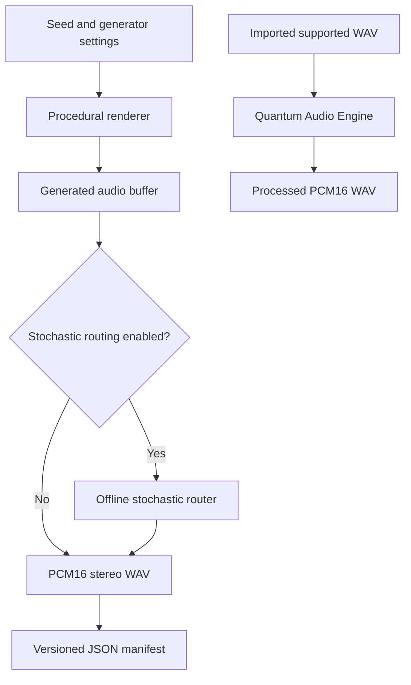

# VentuSample — procedural sample workstation

[English](README.md) · [Українська](README.uk.md) · [Русский](README.ru.md) · [简体中文](README.zh-CN.md)

[CI](https://github.com/Ivan-VHS/VentuSample/actions/workflows/ci.yml) · C++20 · Qt 6 Widgets · Windows/Linux · Offline · Apache-2.0

VentuSample is a native workstation for deterministic procedural hip-hop sample packs. Its scalar renderer exports PCM16 stereo WAV files and versioned JSON manifests without requiring a DAW, audio device or network connection. An optional build-time bridge can link Reaper's native C17 expression runtime for deterministic integer control expressions; all audio generation and DSP remain in C++20.

## Live Windows desktop

<p align="center"></p>
<sub>Actual application capture · 1920×1080 source image · original pixels retained; no artificial upscaling.</sub>

## Audio generation and processing flow

The first flow shows the current offline path from seeded generation through optional stochastic routing to WAV and manifest output.



## Plugin discovery and execution boundary

Plugin manifests are inspected as metadata. A discovered entry is not executable until an explicitly reviewed native handler is attached.


## Generator matrix

| Output | Content |
|---|---|
| Full Loop | drums, melody, bass and optional source chops |
| Melody | chords and seeded note variations |
| Drums | kick, snare, hats, percussion and rolls |
| Bass | generated bass patterns and optional glide |
| One-Shot Kit | 8 hits; tonal labels only for pitched sounds |

There are 14 procedural profiles: Boom Bap, Billionaire Golden Era, East Coast, Harlem Dip-Trap, G-Unit, Modern Trap, Atlanta Trap, UK Drill, UK Grime, Memphis, Jazz Rap, G-Funk, Boom Trap and Cripple Trill.

| Control | Supported range |
|---|---|
| BPM / bars / variations | 60–190 / 1–16 / 1–32 |
| Key / scale | C–B / 6 scale families |
| Swing | 50–68% |
| Density, grit, saturation, stereo | 0–100% |
| High-pass / low-pass | 20–300 Hz / 2–20 kHz |
| Snare offset | −30…+30 ms |
| Bus compression | 1:1–12:1 |
| Sample rate | 22.05 / 44.1 / 48 / 96 kHz |
| Source WAV | PCM16 mono/stereo, 8–192 kHz, ≤128 MiB, ≤20M frames |
| Chop pitch / mix | −12…+12 semitones / 0–100% |

## Reaper 0.2 offline language integration

The native C++20 generator remains the audio engine. An optional Reaper 0.2 `.rpr` script audits generated v2 pack metadata, including tonal and stochastic fields, and writes a read-only comparison report. CI runs the script after generating a real C++ pack fixture; it does not enter the audio callback or open WAV content.

See [Reaper language integration](docs/REAPER_LANGUAGE_INTEGRATION.md).

## Optional Reaper C17 runtime

VentuSample can optionally link Reaper's standalone C17 integer-expression ABI. See [Reaper runtime integration](docs/REAPER_RUNTIME_INTEGRATION.md). The bridge is configured explicitly at build time with `-DREAPER_SOURCE_DIR=/absolute/path/to/Reaper`; it is disabled by default, does not discover or download libraries at runtime, and does not replace the C++20 audio engine or enter the real-time DSP path.

## Internal plugin platform

The native PluginManager includes 19 built-in internal tools. The **Плагины → Менеджер плагинов** view supports inspection, enable/disable and bounded dispatch. A public C++20 SDK exposes reviewed handler registration, lazy initialization, shutdown callbacks and diagnostics.

Local `plugin.json` manifests can be discovered recursively, but discovery is metadata-only. A discovered entry remains disabled until a reviewed native handler is explicitly attached. Automatic DLL/SO loading, manifest-driven code execution, marketplace installation and sandbox claims are not supported. The public manifest contract is [ivan-vhs.plugin.v1](schemas/ivan-vhs.plugin.v1.schema.json). See [Plugin platform and SDK](docs/PLUGINS.md).

## Quantum Audio Engine — 133 DSP modules

Open **Плагины → Quantum Audio Engine — 133 DSP** for the separate offline audio laboratory. It contains 133 stable module identities across five families and routes them through 21 reusable, tested C++ DSP kernels. Load a supported WAV, assemble an ordered chain, adjust Amount / Tone / Rate / Wet-Dry, process offline and export stereo PCM16 WAV.

The catalogue is a creative signal-processing system, not physical quantum computation. It is not a real-time audio engine, DAW, VST/AU host or arbitrary native-library loader. See [Quantum Audio Engine](docs/QUANTUM_AUDIO_ENGINE.md) for input/output constraints, catalogue and DSP boundaries.

## Atomic-Quantum 133 simulation layer

A separate C++20 research library registers 133 atomic/quantum operation IDs and implements a bounded state-vector subset: state validation, normalization, Hadamard/phase/Pauli/CNOT/SWAP gates, Bell/GHZ preparation, seeded projective measurement, stochastic noise trajectories and pure-state fidelity. This is distinct from the existing **Quantum Audio Engine — 133 DSP modules** above: the audio catalogue remains intact and is not physical quantum computing. Advanced research functions remain catalogued until their numerical models are independently implemented and tested. See [Atomic-Quantum 133](docs/ATOMIC_QUANTUM_133.md).

## Stochastic routing

The optional **Stochastic Router** processes rendered audio buffers before PCM16 WAV export. Its weighted pool contains eight selectable processors: low-pass, high-pass, saturator, bitcrusher, delay, reverb, ring modulation and stereo width. It does not load, discover or instantiate arbitrary third-party plugins.

- **Topologies:** hybrid, serial or parallel; parallel routing uses 2–4 branches when enough effects are enabled.
- **Triggers:** one route per file, per bar, or per scheduled generator event. Event mode uses renderer-supplied event frames; imported WAV files are not separately transient-detected.
- **Controls:** intensity 0–100%; aggression, space, dirt and chaos follow the generator's grit, stereo, saturation and density controls.
- **Boundaries:** wet ≤65%, feedback ≤72%, segment fades 5–20 ms, RMS compensation 0.5–2×, and output sample peak guarded at ≤−0.3 dBFS.
- **Repeatability:** the generator seed, variation, topology, trigger and enabled-effect mask determine the route.

The generator option is off by default. When enabled, routing runs offline on the rendered float buffer before PCM16 encoding; manifest v2 records the settings and selected route names per output file. A Plugin Manager run performs a one-bar in-memory preview and does not write files.

This is an **offline DSP path**. It is not a real-time callback, playback hot-swap system, VST/AU host or arbitrary third-party audio-plugin loader.

## Build and test

Requirements: CMake 3.21+, a C++20 compiler and Qt 6 Widgets for the desktop application.

```sh
cmake -S . -B build -DCMAKE_BUILD_TYPE=Release -DVENTU_BUILD_DESKTOP=ON -DVENTU_BUILD_TESTS=ON
cmake --build build --parallel
ctest --test-dir build --output-on-failure
```

Without Qt, the portable DSP core and tests can still build; the desktop target is skipped. CI checks Python project contracts, native C++20 code and the Qt desktop build on Linux and Windows.

## Export, determinism and limits

- Fixed seed and settings produce repeatable renders; rendering runs on a worker thread.
- Manifest v2 records effective settings, `musical_key`, `mode_family`, `scale` and per-file peak/RMS/crest. Manifest v1 remains readable for older packs.
- Full Loop, Melody and Bass may receive key/mode labels. Unpitched drums do not. Imported WAV files are not automatically key-detected.
- Master ceiling is approximately −0.3 dBFS sample peak; it is not an oversampled true-peak limiter.
- Semitone resampling changes pitch and playback speed together; it is not time-stretching.
- No network telemetry, background audio capture, real-time callback or implicit native-library loading.
- Import/export requires appropriate source rights. A hash proves byte identity, not ownership.

[Apache-2.0](LICENSE)


## Bounded resource-allocation reference
An illustrative 500 UAH budget model with a versioned JSON contract and an offline simulator. This is a documentation example, not a feature of the host runtime.

[Multilingual guide](docs/RESOURCE_ALLOCATION_500_UAH.md) · [Interactive simulator](docs/resource-allocation-500-uah.html) · [JSON example](examples/resource-allocation-500-uah.json) · [JSON Schema](schemas/resource-allocation.v1.schema.json)

## Cross-repository plugin federation

This repository's host adapter, shared 18-plugin catalog and compatibility rules are documented in [Plugin Federation](docs/PLUGIN_FEDERATION.md). The machine-readable host declaration is `federation/plugins/host.v1.json`.


## CareGuard v1 — engineering support and language safety

The native C++20 core adds bounded project-load assessment, non-destructive language review, valid help-request handling, manual support-path selection, evidence references, clinical-action boundaries and a deterministic maintenance reserve. It does not monitor or diagnose people.

See [CareGuard v1 contract and safety boundaries](docs/CARE_GUARD_V1.md).

## Beelzebul repository protection

This repository uses the versioned [Beelzebul 66-rule security policy](SECURITY.md), machine-readable [policy](security/beelzebul.v1.json), and read-only [scanner](tools/beelzebul.py). Run `python tools/beelzebul.py` locally; GitHub Actions runs the same gate for pull requests and protected-branch updates.

## Transactional runtime

Bounded in-memory state transitions, integrity checks, optimistic generation commits and rollback are documented in [Transactional Runtime Contract v1](docs/TRANSACTIONAL_RUNTIME.md). This does not enable firmware flashing or unrestricted executable loading.


## CLife sample-workstation savepoints

CLife creates bounded, SHA-256-verified snapshots of project files, manifests, presets and exported packs. Recovery is an offline copy to a new directory; it never runs in the audio callback or changes rendered audio.

[OCTA-8 native adapter](docs/OCTA8.md) · [CLife documentation](docs/CLIFE.md) · Run `python tools/clife.py snapshot .`.
