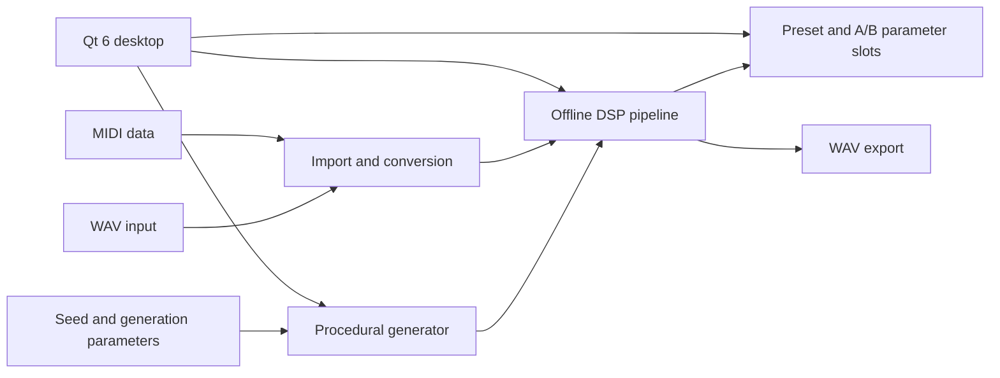

# VentuSample — Procedural Sample Workstation

**A native procedural sample workstation built around a C++20/Qt 6 desktop application and an offline audio-processing core.**

<p align="center">
  
</p>

<p align="center">
  <a href="assets/screenshots/ventusample-studio.png">
    
  </a>
</p>

<p align="center">
  [](https://github.com/Ivan-VHS/VentuSample/actions/workflows/ci.yml)
  [](LICENSE)
</p>

[English](README.md) · [Українська](README.uk.md) · [Русский](README.ru.md) · [简体中文](README.zh-CN.md)

**Scope:** local sound generation, parameter editing, offline DSP and file export. VentuSample is not a real-time DAW, VST/AU host, cloud service or hardware audio driver.

## Audio workflow



This is an offline processing workflow. It does not describe a real-time device callback, plugin host or live audio engine.

## Capabilities

| Work area | What it provides |
|---|---|
| Procedural generation | Samples, presets and repeatable generation settings |
| Parameter workflow | In-session A/B parameter slots |
| Audio processing | Offline DSP and bounded file handling |
| Interchange | WAV import/export, MIDI and sample-rate conversion |
| Extension surface | Plugin SDK and versioned pack manifests with explicit metadata and trust boundaries |
| Desktop | C++20 core with an optional Qt 6 Widgets application |

See [Features](docs/FEATURES.md), [Architecture](docs/ARCHITECTURE.md), [Quantum Audio Engine](docs/QUANTUM_AUDIO_ENGINE.md), [MIDI and resampling](docs/MIDI_AND_RESAMPLING.md), [Plugins](docs/PLUGINS.md) and [Source integration](docs/SOURCE_INTEGRATION.md).

## Build and test

Requirements: CMake, a C++20 compiler and Qt 6 Widgets for the desktop application. The portable core can be built without Qt.

**Linux desktop**
```sh
sudo apt-get update
sudo apt-get install -y cmake ninja-build g++ qt6-base-dev
cmake -S . -B build -G Ninja -DCMAKE_BUILD_TYPE=Release -DVENTU_BUILD_DESKTOP=ON -DVENTU_BUILD_TESTS=ON
cmake --build build --parallel 2
ctest --test-dir build --output-on-failure
```

**Portable core without Qt**
```sh
cmake -S . -B build-core -DCMAKE_BUILD_TYPE=Release -DVENTU_BUILD_DESKTOP=OFF -DVENTU_BUILD_TESTS=ON
cmake --build build-core --parallel
ctest --test-dir build-core --output-on-failure
```

**Windows with MSVC and Qt 6**
```sh
cmake -S . -B build -A x64 -DCMAKE_BUILD_TYPE=Release -DVENTU_BUILD_DESKTOP=ON -DVENTU_BUILD_TESTS=ON
cmake --build build --config Release --parallel 2
ctest --test-dir build -C Release --output-on-failure
```

## Formats and integrations

- Preset contract: [ventusample.preset.v1 schema](schemas/ventusample.preset.v1.schema.json).
- [Documentation index](docs/README.md) · [Reaper pack audit](docs/REAPER_PACK_AUDIT.md) · [Release process](docs/RELEASE.md).
- [Shared ecosystem standards](https://github.com/Ivan-VHS/DuckOS/blob/main/docs/SHARED_STANDARDS.md).

[Contributing](CONTRIBUTING.md) · [Security policy](SECURITY.md) · [Apache-2.0](LICENSE)
