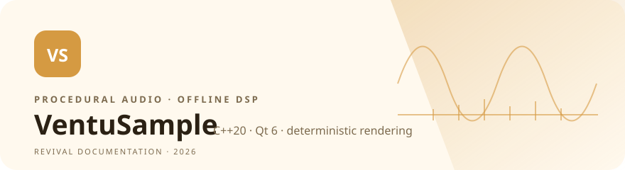
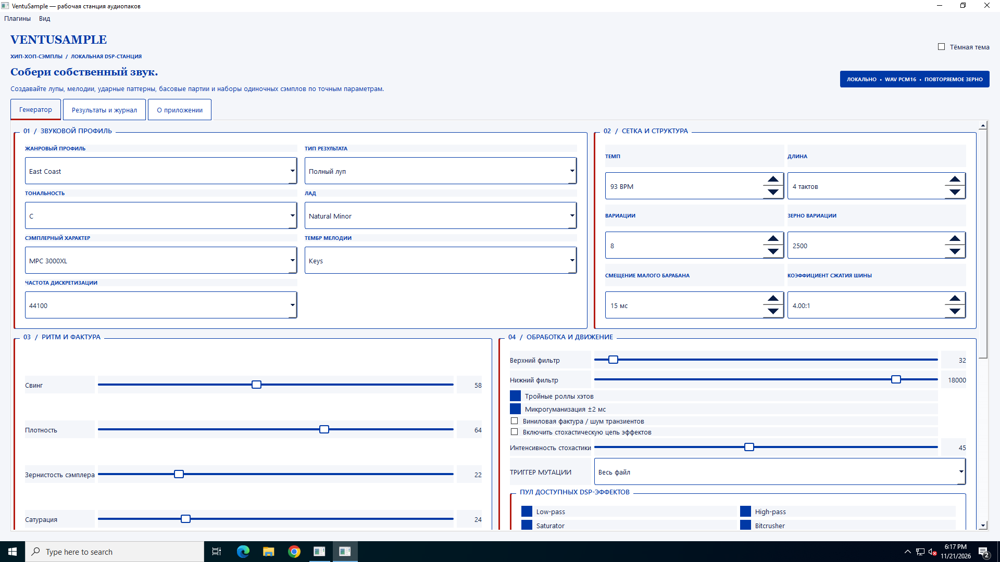
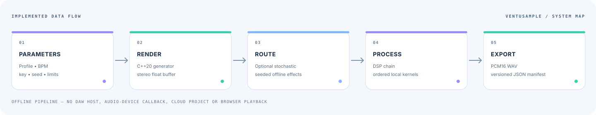

<picture><source media="(prefers-color-scheme: dark)" srcset="assets/readme/hero-banner-dark.svg"><source media="(prefers-color-scheme: light)" srcset="assets/readme/hero-banner-light.svg"></picture>

<h1 align="center">VentuSample — Procedural Sample Workstation</h1>

<strong>An offline C++20 workstation for deterministic sample generation, validated WAV import, creative DSP processing and PCM16 export.</strong>

 

[Quick start](#quick-start) · [Revival](#documentation-revival) · [Visuals](#visual-overview) · [Architecture](#architecture) · [Docs](docs/README.md)

> **Product boundary:** VentuSample renders and processes audio offline. It is not a real-time audio engine, DAW, VST/AU host or cloud service. The optional Qt 6 desktop shell is separate from the portable DSP/core build. Plugin discovery is metadata-only unless an explicitly reviewed native handler is registered.

## Quick start

**Requirements:** CMake 3.21+, a C++20 compiler (GCC, Clang or MSVC) and Git. Qt 6 Widgets is required for the desktop application; the core can be built without Qt. Ninja is optional.

Linux desktop build (Ubuntu 24.04 packages used by CI):

~~~sh
sudo apt-get update
sudo apt-get install -y cmake ninja-build g++ qt6-base-dev
git clone https://github.com/Ivan-VHS/VentuSample.git
cd VentuSample
cmake -S . -B build -G Ninja -DCMAKE_BUILD_TYPE=Release -DVENTU_BUILD_DESKTOP=ON -DVENTU_BUILD_TESTS=ON
cmake --build build --parallel 2
ctest --test-dir build --output-on-failure
./build/VentuSample
~~~

Portable core without Qt:

~~~sh
cmake -S . -B build-core -DCMAKE_BUILD_TYPE=Release -DVENTU_BUILD_DESKTOP=OFF -DVENTU_BUILD_TESTS=ON
cmake --build build-core --parallel
ctest --test-dir build-core --output-on-failure
~~~

Windows uses MSVC and Qt 6:

~~~sh
cmake -S . -B build -A x64 -DCMAKE_BUILD_TYPE=Release -DVENTU_BUILD_DESKTOP=ON -DVENTU_BUILD_TESTS=ON
cmake --build build --config Release --parallel 2
ctest --test-dir build -C Release --output-on-failure
~~~

## Documentation revival

| Before | Revival documentation |
|---|---|
| Single static hero | Paired light/dark SVG hero with accessible fallback |
| Generator, DSP and desktop UI described together | Clear offline-rendering pipeline and explicit product boundaries |
| Screenshot and workflow visual not consistently distinguished | Real Studio capture paired with a separately labelled data-flow illustration |
| Build choices spread across long instructions | Linux desktop, Windows desktop and Qt-free core paths shown separately |
| Feature status spread across detailed pages | Short implementation matrix linked to DSP, plugin and architecture contracts |

This is a documentation refresh, **not a software version or release announcement**. Rendering behavior and maturity remain defined by code, tests, manifests and schemas.

## Implemented scope

| Area | Current behavior | Boundary |
|---|---|---|
| Procedural generator | Loop, Melody, Drums, Bass and One-Shot Kit outputs; 14 generator profiles | Deterministic when seed and settings are fixed |
| Audio I/O | PCM16 WAV import/export and versioned JSON manifest | Validated local files; no cloud sync |
| Offline DSP | Filters, saturation, linked stereo compression, limiting and measurements | Offline buffers; no audio-device callback |
| Quantum Audio Engine | Typed module catalogue and reusable processing kernels | Creative DSP terminology, not physical quantum computation |
| Stochastic Router | Optional seeded routing through built-in processors | Offline processing; disabled by default |
| Plugin Manager | Built-in tools and reviewed C++ handler API | Metadata discovery does not load arbitrary DLL/SO files |
| MIDI / analysis | Bounded MIDI inspection and offline FFT measurements | No MIDI device or playback path |
| Reaper bridge | Optional C17 integer-expression ABI | Explicit local source path; not the DSP engine |

## Visual overview

<table><tr><td width="50%">
<strong>Real desktop capture</strong> — the running application, not a mock-up.
</td><td width="50%">
<strong>Architecture illustration</strong> — audio data path, not a UI screenshot.
</td></tr></table>

## Architecture

~~~mermaid
flowchart LR
  A[Parameters + seed] --> B[C++20 generator]
  B --> C[Stereo float buffer]
  C --> D[Optional offline DSP / routing]
  D --> E[PCM16 WAV]
  D --> F[Versioned JSON manifest]
  G[Qt 6 desktop shell] --> A
  H[Validated WAV input] --> D
  I[Native tests] --> B
~~~

## Configuration and trust

There is no root .env, account system, API token or network requirement. Actual CMake options:

| Option | Default | Purpose |
|---|---:|---|
| VENTU_BUILD_DESKTOP | ON | Build the Qt 6 Widgets desktop target when available |
| VENTU_BUILD_TESTS | ON | Build native tests |
| VENTU_ENABLE_SANITIZERS | OFF | Enable ASan/UBSan on supported GCC/Clang builds |
| REAPER_SOURCE_DIR | empty | Explicit local Reaper checkout for the optional expression bridge |

Plugin manifests are discovered as metadata. A plugin remains inactive until an explicitly reviewed native C++ handler is attached; arbitrary entrypoints and DLL/SO payloads are not loaded.

## Repository map

| Path | Responsibility |
|---|---|
| src/ | C++20 generator, renderer, DSP kernels, plugin manager, Qt UI and optional bridge |
| src/compat/pytyliki-dsp/ | Migrated C11 buffer-processing library |
| integrations/cockos-reaper/ | Optional REAPER Lua helper actions |
| tests/ | Native DSP, generator, manifest, UI and regression tests |
| schemas/ | Versioned preset, plugin and report contracts |
| docs/ | Audio pipeline, plugins, presets, architecture and UI contracts |
| assets/readme/ | Theme-aware hero and workflow illustration |
| assets/screenshots/ | Captured desktop UI |
| .github/workflows/ | Native CI and project-quality checks |

## Verification and current status

~~~sh
cmake --build build --config Release --parallel
ctest --test-dir build -C Release --output-on-failure
git diff --check
~~~

See [Architecture](docs/ARCHITECTURE.md), [Features](docs/FEATURES.md), [Plugin Manager](docs/PLUGINS.md), [MIDI and resampling](docs/MIDI_AND_RESAMPLING.md) and [Quantum Audio Engine](docs/QUANTUM_AUDIO_ENGINE.md). CI screenshots are workflow artifacts; do not infer a public web deployment or tagged Windows release from a passing test.

## Contributing

Read [CONTRIBUTING.md](CONTRIBUTING.md), [README Visual Standard](docs/README_VISUAL_STANDARD.md) and [SECURITY.md](SECURITY.md). Changes to DSP, file bounds, manifests or plugin lifecycle need focused native tests.

## License

[Apache-2.0](LICENSE).
