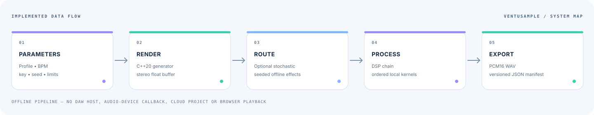

# VentuSample

VentuSample — нативная рабочая станция на C++20 для процедурной генерации hip-hop сэмпл-паков и offline-обработки WAV, с опциональным desktop-интерфейсом Qt 6.

[English](README.md) · [Українська](README.uk.md) · [Русский](README.ru.md) · [简体中文](README.zh-CN.md)

<picture><source media="(prefers-color-scheme: dark)" srcset="assets/readme/dashboard.svg"></picture>

  

[Быстрый старт](#быстрый-старт) · [Скриншоты](#скриншоты) · [Архитектура](#архитектура) · [План развития](#план-развития) · [Документация](docs/README.md)

> **Статус:** активная разработка. В репозитории есть ядро генерации C++20, вспомогательная DSP-библиотека C11, детерминированные тесты и опциональное desktop-приложение Qt 6. CI собирает Linux core/Qt и Windows desktop.
>
> **Требования:** CMake 3.21+, компиляторы C++20 и C11, Git. Для desktop UI нужен Qt 6 Widgets; без Qt можно отключить desktop target.

## Быстрый старт

Linux с Qt 6:

~~~sh
sudo apt-get update
sudo apt-get install -y cmake ninja-build g++ qt6-base-dev
cmake -S . -B build -G Ninja -DCMAKE_BUILD_TYPE=Release -DVENTU_BUILD_DESKTOP=ON -DVENTU_BUILD_TESTS=ON
cmake --build build --parallel 2
ctest --test-dir build --output-on-failure
~~~

Portable core без Qt:

~~~sh
cmake -S . -B build-core -DCMAKE_BUILD_TYPE=Release -DVENTU_BUILD_DESKTOP=OFF -DVENTU_BUILD_TESTS=ON
cmake --build build-core --parallel
ctest --test-dir build-core --output-on-failure
~~~

Windows с Visual Studio 2022 и настроенным Qt 6:

~~~powershell
cmake -S . -B build -A x64 -DCMAKE_BUILD_TYPE=Release -DVENTU_BUILD_DESKTOP=ON -DVENTU_BUILD_TESTS=ON
cmake --build build --config Release --parallel 2
ctest --test-dir build -C Release --output-on-failure
~~~

## Возможности и границы

| Область | Реализовано | Граница |
|---|---|---|
| Генератор | Full Loop, Melody, Drums, Bass, One-Shot Kit | Локальная генерация с настройками и seed |
| Экспорт | Stereo PCM16 WAV и versioned JSON manifest | Локальные файлы, без перезаписи существующих |
| WAV import | PCM16 mono/stereo | Проверка формата, frame count, sample rate и размера |
| Quantum Audio Engine | 133 module identities и 21 reusable kernel | Offline DSP, не физические квантовые вычисления |
| C11 DSP | Фильтры, compressor, saturation, limiter, resampling и спектральные утилиты | Отдельная bounded C11 library |
| Spectrum | FFT peak, spectral centroid, 85% rolloff | Только существующие buffers; FFT 256–65 536 points |
| MIDI | Чтение Standard MIDI File format 0/1, нот, tempo и time signature | Read-only parser, без MIDI-устройств |
| Stochastic Router | Опциональная seeded variation | Повторяемость при фиксированных настройках и seed |
| Presets | Локальная schema v1 и A/B slots | Локальные source paths не экспортируются |
| Plugin tooling | 19 встроенных инструментов и metadata-only discovery | Произвольные DLL/SO не загружаются |
| Reaper bridge | Опциональный native C17 integer-expression ABI | Требуется явный локальный checkout Reaper |

VentuSample — **не DAW, не real-time audio engine, не хост аудиоустройств и не веб-сервис**. Генерация и DSP работают с локальными буферами и файлами. Atomic-Quantum — классическая симуляция, а не квантовое оборудование.

## Зачем нужен VentuSample

- Детерминированная генерация сэмплов и локальные манифесты параметров.
- Ядро C++20 и отдельная тестируемая DSP-библиотека C11.
- Offline-обработка не зависит от аудиоустройств и real-time scheduler.
- Versioned presets поддерживают A/B и не содержат машинно-зависимых путей.
- Опциональные интеграции включаются явно; произвольные native plugin binaries не загружаются.

## Скриншоты

<picture><source media="(prefers-color-scheme: dark)" srcset="assets/readme/workflow-dark.svg"></picture>

Снимок Windows 1920×1080 из desktop CI workflow. Схема выше — векторная архитектурная иллюстрация.

## Архитектура

~~~mermaid
flowchart LR
 A[Параметры и seed] --> B[Генератор C++20]
 B --> C[Стерео float buffer]
 C --> D[Offline C11 DSP]
 D --> E[PCM16 WAV и JSON manifest]
 F[Опциональный Qt 6 desktop] --> A
 G[Опциональный Reaper C17 bridge] --> B
~~~

| Путь | Назначение |
|---|---|
| src/ | Генератор C++20, DSP, presets и Qt desktop |
| src/compat/pytyliki-dsp/ | DSP library C11 |
| tests/ | Тесты генератора, DSP, presets и контрактов |
| schemas/ | Versioned JSON schemas |
| docs/ | Audio, architecture, UI, quality и integration |
| assets/screenshots/ | Снимки Qt desktop |

## Presets и A/B

Presets используют локальный versioned JSON. Они сохраняют профиль и настройки генерации/DSP; random seed исключён по умолчанию, если пользователь явно не выбирает его включение. Два in-session A/B slots переключают снимки параметров без записи файлов. Source-sample paths не экспортируются.

Схема: [Preset v1](schemas/ventusample.preset.v1.schema.json). Cloud sync отсутствует; проект не заявляет права на импортированное или сгенерированное аудио.

## Совместимость

| Цель | Требования | CI / область |
|---|---|---|
| Linux core и desktop | CMake 3.21+, C++20/C11, Qt 6 Widgets для UI | Ubuntu 24.04, Qt 6 |
| Windows desktop | Visual Studio 2022, CMake 3.21+, Qt 6 Widgets | Windows Server 2022, Qt 6.8.3 |
| Portable core | CMake 3.21+, C++20/C11 | VENTU_BUILD_DESKTOP=OFF |
| Python tooling | Python 3.10–3.12 | Только инженерные проверки |
| Reaper bridge | Опциональный локальный source tree Reaper | Явный REAPER_SOURCE_DIR |

Если Qt 6 Widgets отсутствует, отключите desktop target через VENTU_BUILD_DESKTOP=OFF и соберите portable core вместе с тестами.

## README Revival

- На первом экране есть назначение, зрелость, toolchain и build/test команды.
- Настоящий Windows capture отделён от архитектурных схем.
- Локальные светлые/тёмные SVG имеют одинаковые размеры.
- Offline-границы, Qt dependency, presets и plugin limits описаны явно.

| Было | Стало |
|---|---|
| Обзор перед сборкой | Команды сборки и тестирования в начале |
| Только одна тема графики | Адаптивные локальные SVG |
| Опциональные зависимости описаны поздно | Qt и Reaper bridge обозначены сразу |
| Общие описания | Таблица реализации и ограничений |

## План развития

- [x] Генератор C++20 и DSP support library C11.
- [x] Offline WAV export, JSON manifest и validation source WAV.
- [x] Qt 6 desktop и детерминированные native tests.
- [x] Versioned local presets и A/B slots.
- [ ] Развивать DSP с deterministic fixtures и numerical regression tests.
- [ ] Добавлять форматы вместе со схемами, bounded parser и тестами совместимости.

## Экосистема

- [DuckOS](https://github.com/Ivan-VHS/DuckOS) — операционная система и рабочее пространство Mora.
- [Reaper](https://github.com/Ivan-VHS/Reaper) — системный язык и опциональный native expression bridge.
- [Pytyliki](https://github.com/Ivan-VHS/Pytyliki) — процессорные исследования и системные утилиты.
- [OPlague](https://github.com/Ivan-VHS/OPlague) — анализ устройств и драйверов.

См. [документацию](docs/README.md), [архитектуру](docs/ARCHITECTURE.md), [визуальный стандарт](docs/README_VISUAL_STANDARD.md), [CONTRIBUTING](CONTRIBUTING.md) и [issues](https://github.com/Ivan-VHS/VentuSample/issues). Лицензия: Apache-2.0.
