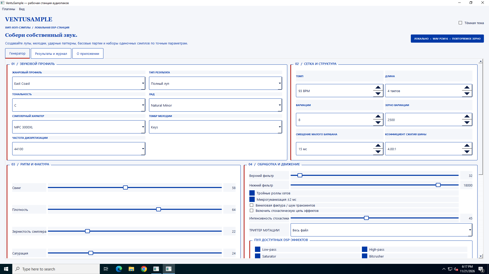
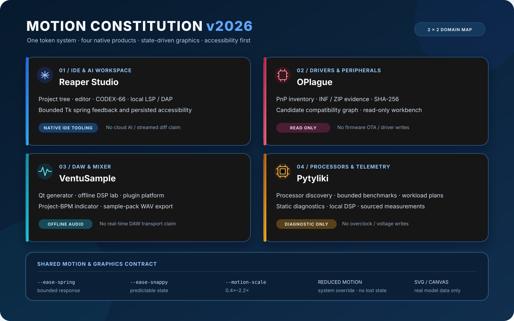

# VentuSample — процедурная рабочая станция сэмплов

[CI](https://github.com/Ivan-VHS/VentuSample/actions/workflows/ci.yml) · C++20 · Qt 6 Widgets · Windows/Linux · офлайн · Apache-2.0

VentuSample — нативная рабочая станция для детерминированной генерации хип-хоп-сэмпл-паков. Скалярный рендерер экспортирует стерео PCM16 WAV и версионированные JSON-манифесты без DAW, аудиоустройства или сети.

[English](README.md) · [Українська](README.uk.md) · [简体中文](README.zh-CN.md) · [Русский](README.ru.md)

## Реальный снимок Windows
<p align="center"></p>
<sub>Реальный снимок Windows 11, 1920×1080, из Qt CI-сборки. Показана рабочая область генератора; поиск плагинов и DSP-лаборатория открываются отдельно из меню.</sub>

## Движение интерфейса и доступность
**View → Motion Settings** сохраняет настройки **Reduce Motion**, **Eco / Low-CPU Visuals** и **Sync to BPM**. Внутренний BPM проекта управляет сдержанным индикатором ритма; это обратная связь по темпу проекта, а не внешний DAW-транспорт. Reduce Motion и Eco приостанавливают индикатор и ограничивают переходы 80 мс. Анимации Qt и таймер работают в UI-потоке, вне DSP-callback, аудиобуферов, генераторных потоков и стохастической маршрутизации. См. [контракт движения интерфейса](docs/UI_MOTION.md).

## Генератор
| Выход | Содержимое |
|---|---|
| Full Loop | ударные, мелодия, бас и необязательные исходные chops |
| Melody | аккорды и вариации нот с фиксируемым seed |
| Drums | kick, snare, hats, percussion и rolls |
| Bass | басовые паттерны и необязательный glide |
| One-Shot Kit | 8 звуков; тональные метки только для звуков с высотой тона |

14 профилей: Boom Bap, Billionaire Golden Era, East Coast, Harlem Dip-Trap, G-Unit, Modern Trap, Atlanta Trap, UK Drill, UK Grime, Memphis, Jazz Rap, G-Funk, Boom Trap и Cripple Trill.

Диапазоны: BPM 60–190; 1–16 тактов; 1–32 вариации; 6 семейств гамм; swing 50–68%; плотность/grit/сатурация/стерео 0–100%; high-pass 20–300 Гц; low-pass 2–20 кГц; смещение snare ±30 мс; bus compression 1:1–12:1; частота 22.05/44.1/48/96 кГц. Исходный WAV: PCM16 mono/stereo, 8–192 кГц, ≤128 МиБ и ≤20 млн кадров. Pitch chop ±12 полутонов, mix 0–100%.

## Внутренняя платформа плагинов
PluginManager включает 19 встроенных инструментов. **Плагины → Менеджер плагинов** поддерживает просмотр, включение/отключение и ограниченный dispatch. Публичный SDK C++20 предоставляет проверяемую регистрацию обработчиков, отложенную инициализацию, callbacks завершения и диагностику. Рекурсивный поиск локальных `plugin.json` читает только метаданные; запись остаётся выключенной до явного подключения проверенного нативного обработчика. Автозагрузка DLL/SO, выполнение кода из манифеста, marketplace-инсталляция и заявления о sandbox не поддерживаются. Контракт: [ivan-vhs.plugin.v1](schemas/ivan-vhs.plugin.v1.schema.json). Подробнее: [Plugin platform and SDK](docs/PLUGINS.md).

## Quantum Audio Engine — 133 DSP-модуля
**Плагины → Quantum Audio Engine — 133 DSP** открывает отдельную офлайн-лабораторию: 133 стабильных ID в пяти семействах, обработка через 21 повторно используемое протестированное DSP-ядро C++. Загрузите WAV, соберите цепочку, настройте Amount / Tone / Rate / Wet-Dry и экспортируйте стерео PCM16 WAV. Это творческая система обработки сигнала, а не физические квантовые вычисления; она не является real-time движком, DAW, VST/AU-хостом или загрузчиком произвольных нативных библиотек. См. [Quantum Audio Engine](docs/QUANTUM_AUDIO_ENGINE.md).

## Atomic-Quantum 133
Отдельная исследовательская библиотека C++20 регистрирует 133 атомарных/квантовых ID и реализует ограниченное подмножество: проверку состояния, нормализацию, Hadamard/phase/Pauli/CNOT/SWAP, Bell/GHZ, проективное измерение с seed, стохастические траектории шума и fidelity чистого состояния. Это отдельная система от аудиокаталога; физические квантовые вычисления не заявляются. Расширенные функции остаются в каталоге до независимой реализации и тестирования моделей. См. [Atomic-Quantum 133](docs/ATOMIC_QUANTUM_133.md).

## Стохастическая маршрутизация
Необязательный **Stochastic Router** обрабатывает рендеренные буферы до экспорта WAV. Взвешенный пул включает low-pass, high-pass, saturator, bitcrusher, delay, reverb, ring modulation и stereo width. Поддерживаются topology hybrid/serial/parallel, триггеры на файл/такт/событие, intensity 0–100%, wet ≤65%, feedback ≤72%, fades 5–20 мс, RMS compensation 0.5–2× и sample peak ≤−0.3 dBFS. Маршрут определяется seed, вариацией, топологией, триггером и маской эффектов. Опция выключена по умолчанию; обработка выполняется офлайн до PCM16-кодирования, manifest v2 записывает параметры маршрута. Это не real-time callback, hot-swap, VST/AU-хост или загрузчик сторонних плагинов.

## Сборка и тесты
Требуются CMake 3.21+, компилятор C++20 и Qt 6 Widgets для desktop-приложения.
```sh
cmake -S . -B build -DCMAKE_BUILD_TYPE=Release -DVENTU_BUILD_DESKTOP=ON -DVENTU_BUILD_TESTS=ON
cmake --build build --parallel
ctest --test-dir build --output-on-failure
```
Без Qt переносимое DSP-ядро и тесты могут собираться отдельно. CI проверяет контракты Python, нативный C++20 и Qt-сборку на Linux и Windows.

## Экспорт и ограничения
- Фиксированные seed и настройки дают повторяемый рендер; обработка идёт в рабочем потоке.
- Manifest v2 записывает настройки, `musical_key`, `mode_family`, `scale` и peak/RMS/crest; manifest v1 остаётся читаемым.
- Full Loop, Melody и Bass могут иметь метки тональности/лада; непитчевые ударные — нет. Импортированные WAV автоматически не анализируются на тональность.
- Master ceiling около −0.3 dBFS sample peak; это не oversampled true-peak limiter.
- Ресемплинг в полутонах меняет высоту и скорость одновременно; это не time-stretching.
- Нет сетевой телеметрии, фонового захвата аудио, real-time callback или неявной загрузки нативных библиотек.
- Для импорта/экспорта нужны права на исходный материал. Хеш подтверждает идентичность байтов, но не право собственности.

[Возможности](docs/FEATURES.md) · [Plugin SDK](docs/PLUGINS.md) · [Quantum Audio Engine](docs/QUANTUM_AUDIO_ENGINE.md) · [Архитектура](docs/ARCHITECTURE.md) · [Руководство](docs/USER_GUIDE_RU.md) · [QMR-20](docs/QUALITY_MONOLITH_RHYTHM.md) · [Аудит Reaper-паков](docs/REAPER_PACK_AUDIT.md) · [Права на исходники](docs/SOURCE_INTEGRATION.md) · [Дизайн Anatidae](docs/ANATIDAE_DESKTOP_DESIGN_SYSTEM.md) · [Индекс](docs/README.md)

[Apache-2.0](LICENSE)

## DUCK CORE // README и Motion Suite

Общий визуальный ориентир для интерактивных демонстраций и UI-документации включает три палитры: **Pond Noir**, **Golden Reed** и **Arctic Glacier**. Используйте семантические токены холста, поверхностей, текста, границ, акцентов и фокуса.

Сдержанная spring-кривая подходит для появления и обратной связи, плавная — для обычных переходов; Zen / Hyper допустимы только как реальные настройки приложения. Параллакс, плавающая геометрия и ripple — необязательный декор. `reduced-motion` отключает декоративное движение и имеет приоритет над остальными режимами.

**Доступность:** контраст, видимый клавиатурный фокус, удобные touch-элементы и адаптивная компоновка обязательны. Анимация не должна мешать вводу или сдвигать контент.

Это визуальный ориентир, а не заявление о наличии всех эффектов в приложении. Реализацию определяет [контракт движения интерфейса](docs/UI_MOTION.md).

## Система документации и визуальные материалы

Для Markdown/MDX, диаграмм, скриншотов, SVG и растровых материалов, доступности, переводов и проверки ссылок действует [единый стандарт README и визуальной документации](docs/README_VISUAL_STANDARD.md).


## Motion Constitution v2026

Общий контракт интерфейса — [Motion Constitution v2026](docs/MOTION_CONSTITUTION_V2026.md). Он унифицирует пружинные/быстрые кривые, диапазон масштаба 0,4×–2,2×, приоритет Reduce Motion, светлую/тёмную темы, стенд 2×2/фокус-сцену и SVG/Canvas-телеметрию на реальных данных. [Нативный контракт Qt](docs/UI_MOTION.md) описывает текущую реализацию: ограниченные переходы в UI-потоке, сохраняемые настройки движения и необязательный индикатор BPM проекта. VentuSample — офлайн-станция генерации сэмплов и DSP, а не DAW реального времени или внешний микшер; уровни и волны должны строиться по реальным preview/render-буферам и не выполняться в DSP-callback или generator-worker.

## Общая карта motion-архитектуры

<p align="center"></p>

Это общая архитектурная схема 2×2, а не снимок работающего приложения. Она отделяет существующие функции от недоступных и планируемых возможностей.
