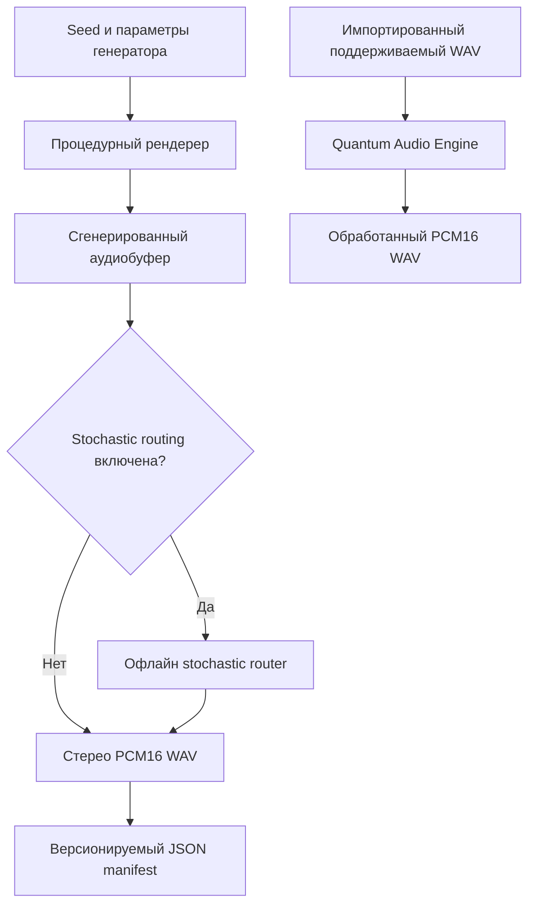

# VentuSample — процедурная рабочая станция сэмплов

[CI](https://github.com/Ivan-VHS/VentuSample/actions/workflows/ci.yml) · C++20 · Qt 6 Widgets · Windows/Linux · офлайн · Apache-2.0

VentuSample — нативная рабочая станция для детерминированной генерации хип-хоп-сэмпл-паков. Скалярный рендерер экспортирует стерео PCM16 WAV и версионированные JSON-манифесты без DAW, аудиоустройства или сети.

[English](README.md) · [Українська](README.uk.md) · [简体中文](README.zh-CN.md) · [Русский](README.ru.md)

## Реальный снимок Windows
<p align="center"></p>
<sub>Фактический снимок приложения · исходное изображение 1920×1080 · исходные пиксели сохранены, искусственное увеличение не применяется.</sub>

## Поток генерации и обработки звука

Первая схема показывает текущий офлайн-путь: генерацию с seed, необязательную стохастическую маршрутизацию и экспорт WAV с manifest.



## Обнаружение плагинов и границы исполнения

Manifest плагинов проверяются как метаданные. Найденная запись не исполняется, пока к ней явно не подключён проверенный нативный обработчик.


## Генератор
| Выход | Содержимое |
|---|---|
| Full Loop | ударные, мелодия, бас и необязательные исходные chops |
| Melody | аккорды и вариации нот с фиксируемым seed |
| Drums | kick, snare, hats, percussion и rolls |
| Bass | басовые паттерны и необязательный glide |
| One-Shot Kit | 8 звуков; тональные метки только для звуков с высотой тона |

14 профилей: Boom Bap, Billionaire Golden Era, East Coast, Harlem Dip-Trap, G-Unit, Modern Trap, Atlanta Trap, UK Drill, UK Grime, Memphis, Jazz Rap, G-Funk, Boom Trap и Cripple Trill.

Диапазоны: BPM 60–190; 1–16 тактов; 1–32 вариации; 6 семейств гамм; swing 50–68%; плотность/grit/сатурация/стерео 0–100%; high-pass 20–300 Гц; low-pass 2–20 кГц; смещение snare ±30 мс; bus compression 1:1–12:1; частота 22.05/44.1/48/96 кГц. Исходный WAV: PCM16 mono/stereo, 8–192 кГц, ≤128 МиБ и ≤20 млн кадров. Pitch chop ±12 полутонов, mix 0–100%.

## Внутренняя платформа плагинов
PluginManager включает 19 встроенных инструментов. **Плагины → Менеджер плагинов** поддерживает просмотр, включение/отключение и ограниченный dispatch. Публичный SDK C++20 предоставляет проверяемую регистрацию обработчиков, отложенную инициализацию, callbacks завершения и диагностику. Рекурсивный поиск локальных `plugin.json` читает только метаданные; запись остаётся выключенной до явного подключения проверенного нативного обработчика. Автозагрузка DLL/SO, выполнение кода из манифеста, marketplace-инсталляция и заявления о sandbox не поддерживаются. Контракт: [ivan-vhs.plugin.v1](schemas/ivan-vhs.plugin.v1.schema.json). Подробнее: [Plugin platform and SDK](docs/PLUGINS.md).

## Quantum Audio Engine — 133 DSP-модуля
**Плагины → Quantum Audio Engine — 133 DSP** открывает отдельную офлайн-лабораторию: 133 стабильных ID в пяти семействах, обработка через 21 повторно используемое протестированное DSP-ядро C++. Загрузите WAV, соберите цепочку, настройте Amount / Tone / Rate / Wet-Dry и экспортируйте стерео PCM16 WAV. Это творческая система обработки сигнала, а не физические квантовые вычисления; она не является real-time движком, DAW, VST/AU-хостом или загрузчиком произвольных нативных библиотек. См. [Quantum Audio Engine](docs/QUANTUM_AUDIO_ENGINE.md).

## Atomic-Quantum 133
Отдельная исследовательская библиотека C++20 регистрирует 133 атомарных/квантовых ID и реализует ограниченное подмножество: проверку состояния, нормализацию, Hadamard/phase/Pauli/CNOT/SWAP, Bell/GHZ, проективное измерение с seed, стохастические траектории шума и fidelity чистого состояния. Это отдельная система от аудиокаталога; физические квантовые вычисления не заявляются. Расширенные функции остаются в каталоге до независимой реализации и тестирования моделей. См. [Atomic-Quantum 133](docs/ATOMIC_QUANTUM_133.md).

## Стохастическая маршрутизация
Необязательный **Stochastic Router** обрабатывает рендеренные буферы до экспорта WAV. Взвешенный пул включает low-pass, high-pass, saturator, bitcrusher, delay, reverb, ring modulation и stereo width. Поддерживаются topology hybrid/serial/parallel, триггеры на файл/такт/событие, intensity 0–100%, wet ≤65%, feedback ≤72%, fades 5–20 мс, RMS compensation 0.5–2× и sample peak ≤−0.3 dBFS. Маршрут определяется seed, вариацией, топологией, триггером и маской эффектов. Опция выключена по умолчанию; обработка выполняется офлайн до PCM16-кодирования, manifest v2 записывает параметры маршрута. Это не real-time callback, hot-swap, VST/AU-хост или загрузчик сторонних плагинов.

## Сборка и тесты
Требуются CMake 3.21+, компилятор C++20 и Qt 6 Widgets для desktop-приложения.
```sh
cmake -S . -B build -DCMAKE_BUILD_TYPE=Release -DVENTU_BUILD_DESKTOP=ON -DVENTU_BUILD_TESTS=ON
cmake --build build --parallel
ctest --test-dir build --output-on-failure
```
Без Qt переносимое DSP-ядро и тесты могут собираться отдельно. CI проверяет контракты Python, нативный C++20 и Qt-сборку на Linux и Windows.

## Экспорт и ограничения
- Фиксированные seed и настройки дают повторяемый рендер; обработка идёт в рабочем потоке.
- Manifest v2 записывает настройки, `musical_key`, `mode_family`, `scale` и peak/RMS/crest; manifest v1 остаётся читаемым.
- Full Loop, Melody и Bass могут иметь метки тональности/лада; непитчевые ударные — нет. Импортированные WAV автоматически не анализируются на тональность.
- Master ceiling около −0.3 dBFS sample peak; это не oversampled true-peak limiter.
- Ресемплинг в полутонах меняет высоту и скорость одновременно; это не time-stretching.
- Нет сетевой телеметрии, фонового захвата аудио, real-time callback или неявной загрузки нативных библиотек.
- Для импорта/экспорта нужны права на исходный материал. Хеш подтверждает идентичность байтов, но не право собственности.

[Apache-2.0](LICENSE)


## Справочник распределения бюджета
Пример модели бюджета 500 грн с JSON-контрактом и автономным симулятором. Это документационный пример, а не функция runtime самого приложения.

[Мультиязычный справочник](docs/RESOURCE_ALLOCATION_500_UAH.md) · [Интерактивный симулятор](docs/resource-allocation-500-uah.html) · [Пример JSON](examples/resource-allocation-500-uah.json) · [JSON Schema](schemas/resource-allocation.v1.schema.json)

## Документация по безопасности

[Границы доверия и безопасная эксплуатация](docs/SECURITY_AND_TRUST_BOUNDARIES.md) · [Каталог Beelzebul AppGuard 666](docs/BEELZEBUL_APPGUARD_666.md) · [Полный индекс документации](docs/README.md)
