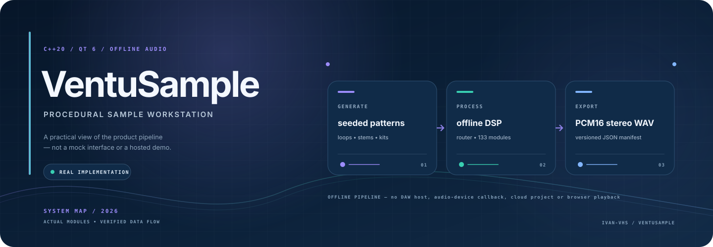

# VentuSample — процедурная рабочая станция сэмплов

[English](README.md) · [Українська](README.uk.md) · [Русский](README.ru.md) · [简体中文](README.zh-CN.md)

<p align="center"></p>

[Исходный код](https://github.com/Ivan-VHS/VentuSample) · [CI workflow](.github/workflows/ci.yml) · [Индекс документации](docs/README.md) · [Apache-2.0](LICENSE)

## Реальный снимок desktop-приложения

<p align="center"><a href="assets/screenshots/ventusample-studio.png"></a></p>
<p align="center"><sub>1920×1080 · Нажмите на изображение, чтобы открыть исходный PNG.</sub></p>

Настоящий скриншот VentuSample, запущенного на Windows CI desktop. Изображение захвачено собранным Qt-приложением; баннер и схема потока данных — отдельные авторские SVG-иллюстрации.

### Архитектура с первого взгляда

<p align="center"></p>

Реальный путь: параметры и seed → C++20 renderer → stereo buffer → необязательный офлайн-DSP → PCM16 WAV и JSON manifest.


[](https://github.com/Ivan-VHS/VentuSample/actions/workflows/ci.yml)  [](https://github.com/Ivan-VHS/VentuSample/actions/workflows/ci.yml)  [](LICENSE)


> **Назначение:** VentuSample — нативная рабочая станция на C++20 для детерминированной процедурной генерации сэмпл-паков и офлайн-обработки WAV. При наличии Qt доступен desktop-интерфейс Qt 6; ядро DSP можно собирать отдельно. Это не hosted web demo, browser sandbox, DAW, host аудиоустройств или production audio service. Документация сверена с `main` **22.11.2026**.

## Назначение и границы

VentuSample создаёт локальные hip-hop sample packs на основе явных параметров и seed. Приложение рендерит аудио, обрабатывает поддерживаемые WAV через офлайн-DSP и записывает версионированные JSON-manifest с настройками и данными о результате. DAW, аудиоинтерфейс, сеть или hosted backend не нужны.

Целевая аудитория — beatmakers, sound designers, разработчики аудио, QA-инженеры и ревьюеры, которым нужна детерминированная и проверяемая генерация сэмплов и повторяемая офлайн-обработка.

### Реализованные возможности

| Область | Реализованное поведение | Граница |
|---|---|---|
| Процедурный генератор | Full Loop, Melody, Drums, Bass и One-Shot Kit | локальный рендеринг; одинаковые seed и настройки воспроизводят тот же результат |
| Экспорт аудио | stereo PCM16 WAV и версионированный JSON-manifest | локальные файлы; существующие файлы не перезаписываются |
| MIDI-экспорт | стандартный MIDI companion из тех же детерминированных note events и BPM | необязательный флажок, выключен по умолчанию; one-shot kits остаются WAV-only |
| Импорт WAV | поддерживаемые исходные PCM16 mono/stereo файлы | проверяются размер, число кадров, sample rate и формат |
| Quantum Audio Engine | 133 типизированных ID модулей и 21 повторно используемое DSP-ядро | творческая офлайн-DSP, не физические квантовые вычисления |
| Stochastic Router | необязательная seeded-маршрутизация через восемь встроенных процессоров | офлайн-обработка буфера; выключено по умолчанию |
| Plugin Manager | 19 встроенных инструментов и проверенный C++20 handler API | обнаружение manifest — только метаданные; без произвольного DLL/SO loading |
| Atomic-Quantum 133 | отдельная ограниченная классическая симуляция | без доступа к квантовому оборудованию |
| Reaper bridge | необязательный C17 integer-expression ABI при сборке | явный локальный путь к source; не часть audio DSP path |

14 профилей генератора: Boom Bap, Billionaire Golden Era, East Coast, Harlem Dip-Trap, G-Unit, Modern Trap, Atlanta Trap, UK Drill, UK Grime, Memphis, Jazz Rap, G-Funk, Boom Trap и Cripple Trill.

Приложение не является real-time аудиодвижком. Рендеринг и DSP выполняются офлайн в worker threads; нет callback аудиоустройства, playback hot-swap, VST/AU host, произвольного загрузчика сторонних плагинов или DAW automation.

Скриншот Windows ниже — снимок desktop-приложения, а не браузерное превью.


## Быстрый старт

### Требования

- CMake **3.21 или новее**.
- Компилятор C++20: GCC, Clang или MSVC.
- Git.
- Qt **6 Widgets** для desktop-приложения. DSP/core library и non-Qt tests можно собирать без Qt.
- Ninja необязателен, но используется Linux desktop job в CI.

Для рендеринга аудио проекта Python или Node.js не нужны. Python 3.10–3.12 используется в CI для проверки project contract и engineering validators.

### Linux: сборка desktop-рабочей станции

В Ubuntu 24.04 установите те же пакеты toolchain, что и CI:

```sh
sudo apt-get update
sudo apt-get install -y cmake ninja-build g++ qt6-base-dev
```

Настройте, соберите и запустите тесты:

```sh
cmake -S . -B build -G Ninja -DCMAKE_BUILD_TYPE=Release -DVENTU_BUILD_DESKTOP=ON -DVENTU_BUILD_TESTS=ON
cmake --build build --parallel 2
ctest --test-dir build --output-on-failure
```

Desktop executable создаётся настроенной сборкой CMake. Для Linux-сборки Ninja запустите `./build/VentuSample`; для Windows Release — `build\\Release\\VentuSample.exe`.

### Переносимое ядро без Qt

Если Qt 6 Widgets не установлен или нужны только DSP engine и тесты:

```sh
cmake -S . -B build-core -DCMAKE_BUILD_TYPE=Release -DVENTU_BUILD_DESKTOP=OFF -DVENTU_BUILD_TESTS=ON
cmake --build build-core --parallel
ctest --test-dir build-core --output-on-failure
```

Если `VENTU_BUILD_DESKTOP=ON`, но Qt 6 Widgets не найден, CMake выведет warning и пропустит desktop target; это не означает, что GUI executable был создан.

### Windows: сборка с MSVC и Qt 6

Используйте Visual Studio 2022 x64 developer environment и установите Qt 6 Widgets (текущий CI использует Qt **6.8.3**, MSVC 2022 x64):

```sh
cmake -S . -B build -A x64 -DCMAKE_BUILD_TYPE=Release -DVENTU_BUILD_DESKTOP=ON -DVENTU_BUILD_TESTS=ON
cmake --build build --config Release --parallel 2
ctest --test-dir build -C Release --output-on-failure
```

Windows CI устанавливает Qt и настраивает соответствующий MSVC toolchain перед запуском этих команд.

### Первая проверка

Успешный `ctest` — общая проверка сборки. Тесты покрывают валидацию параметров, детерминированную повторяемость, вариации, WAV round-trip, stochastic DSP, схемы, lifecycle плагинов и поведение Quantum Audio Engine.

Стандартного HTTP-порта, localhost URL, запуска браузера, seed базы данных или удалённого mock service нет. Генерация и обработка выполняются локально.

## Воспроизводимые данные и тестовые сценарии

VentuSample не использует удалённую базу данных или live API. Генератор работает с локальными параметрами и seed; импортированное аудио поступает из файла, выбранного оператором. Manifest создаётся локально рядом с выходными файлами.

Проверьте следующие сценарии в desktop-приложении:

1. **Повторяемый loop:** выберите profile генератора, BPM, key/scale и фиксированный seed; дважды создайте Full Loop с одинаковыми настройками и сравните аудио и manifest.
2. **Отдельные stems:** создайте Melody, Drums и Bass отдельно и проверьте тип каждого результата.
3. **One-shot kit:** сгенерируйте набор из восьми звуков и проверьте, что tonal labels добавляются только звукам с высотой тона.
4. **Импорт WAV:** загрузите поддерживаемый PCM16 mono/stereo файл и просмотрите его свойства.
5. **Chop и pitch:** выберите до четырёх фрагментов и примените описанный semitone resampling; он одновременно меняет высоту и скорость, а не выполняет time-stretch.
6. **Офлайн DSP-цепочка:** загрузите поддерживаемый WAV в Quantum Audio Engine, соберите упорядоченную цепочку, настройте модули и экспортируйте обработанный WAV.
7. **Stochastic routing:** включите необязательный router, выберите topology/trigger/intensity и выполните новый рендер. Seed, variation, trigger и effect mask определяют маршрут.
8. **Обнаружение плагина:** просмотрите локальный `plugin.json`; обнаруженная запись метаданных остаётся выключенной, пока явно не подключён проверенный native handler.

### Диапазоны генератора и ограничения файлов

| Параметр / вход | Поддерживаемый диапазон |
|---|---|
| BPM / bars / variations | 60–190 / 1–16 / 1–32 |
| Key / scale | C–B / 6 scale families |
| Swing | 50–68% |
| Density / grit / saturation / stereo | 0–100% |
| High-pass / low-pass | 20–300 Hz / 2–20 kHz |
| Snare offset | −30…+30 ms |
| Bus compression | 1:1–12:1 |
| Sample rates | 22.05 / 44.1 / 48 / 96 kHz |
| Imported source | PCM16 mono/stereo, 8–192 kHz |
| Source-file limits | 128 MiB и 20 000 000 frames |
| Chop pitch / mix | −12…+12 semitones / 0–100% |

Low-pass cutoff должен быть выше high-pass cutoff и ниже 0.49× sample rate. Импортированный звук автоматически не анализируется на тональность.

### Контракт Stochastic Router

Router необязателен и **выключен по умолчанию**. Он обрабатывает rendered stereo buffers перед кодированием PCM16 WAV. Встроенный пул включает low-pass, high-pass, saturator, bitcrusher, delay, reverb, ring modulation и stereo width.

| Параметр | Контракт |
|---|---|
| Topology | hybrid, serial или parallel; parallel использует 2–4 ограниченные ветви |
| Trigger | на файл, на такт или renderer-scheduled event frame |
| Intensity | 0–100%; нулевая интенсивность прозрачна |
| Wet / feedback | максимум 65% / 72% |
| Segment crossfade | 5–20 ms |
| RMS compensation | ограничение 0.5–2× |
| Output guard | sample peak ceiling не выше −0.3 dBFS |
| Repeatability | generator seed + variation + trigger index |

Event mode использует scheduled frames, выдаваемые procedural renderer. Он не обнаруживает transient в произвольных импортированных WAV-файлах. Это офлайн signal processing, а не real-time callback или plugin hot-swap.

### Время жизни состояния и хранение

Рабочие аудиобуферы и текущий UI state существуют в процессе приложения. Выходные WAV и JSON-manifest записываются в локальный каталог, выбранный пользователем; существующие файлы не перезаписываются. Закрытие приложения завершает memory session, но не удаляет экспортированные файлы.

Desktop UI хранит собственные настройки через native preferences layer. Нет browser localStorage, sessionStorage, IndexedDB, cookie state, общей серверной базы или автоматической cloud sync. Встроенного latency/HTTP-500 simulator или fallback внешнего сервиса нет, поскольку audio path работает офлайн.

## Конфигурация, окружение и доверие

Корневого `.env.example`, Docker Compose stack, системы аккаунтов, demo credentials, API token, CORS configuration, reverse proxy или локального HTTPS нет. Генерация и обработка аудио не требуют сети.

Параметры сборки из `CMakeLists.txt`:

| CMake option | Значение по умолчанию | Назначение |
|---|---:|---|
| `VENTU_BUILD_DESKTOP` | `ON` | найти Qt 6 Widgets и собрать desktop target при наличии Qt |
| `VENTU_BUILD_TESTS` | `ON` | собрать native tests |
| `VENTU_ENABLE_SANITIZERS` | `OFF` | включить AddressSanitizer/UndefinedBehaviorSanitizer в поддерживаемых сборках GCC/Clang |
| `REAPER_SOURCE_DIR` | пустой | явный локальный checkout Reaper; включает необязательный C17 expression bridge |

Reaper bridge выключен, если явно не задан локальный source directory. Он использует native expression ABI Reaper для детерминированных integer control expressions; не заменяет C++20 engine и не включён в real-time DSP path.

### Граница безопасности плагинов

Plugin Manager включает 19 встроенных инструментов. Локальный `plugin.json` можно рекурсивно обнаружить как метаданные, но найденная запись остаётся выключенной, пока явно не подключён проверенный native handler. Менеджер не загружает manifest entrypoints, произвольные DLL/SO или executable payload. Публичная схема manifest: [ivan-vhs.plugin.v1](schemas/ivan-vhs.plugin.v1.schema.json).

Не рассматривайте обнаружение manifest как выполнение кода или гарантию sandbox. Регистрация handler — явная native C++ операция, которую проверяет приложение.

## Архитектура и структура репозитория

Поток данных: **параметры + seed → procedural renderer → stereo float buffer → optional offline routing/DSP → PCM16 WAV + версионированный JSON-manifest**.

| Путь | Содержимое |
|---|---|
| `src/` | C++20 generator, renderer, audio buffers, DSP kernels, plugin manager, Qt desktop UI и optional Reaper bridge |
| `tests/` | native DSP, generator, manifest, UI, plugin lifecycle и regression tests |
| `docs/` | архитектура, функции, plugin SDK, UI behavior и audio contracts |
| `schemas/` | версионированные sample-pack и plugin manifest schemas |
| `tools/` | project-contract, fixture, visual-canon и engineering validators |
| `federation/` | явные interoperability и adapter manifests |
| `assets/screenshots/` | снимок desktop-приложения |
| `.github/workflows/` | Python contract, native, Linux Qt и Windows Qt CI jobs |
| `CMakeLists.txt` | C++20 build graph и optional feature switches |
| `project-contract.json` | машиночитаемый project contract |

Desktop использует Qt 6 Widgets. Генератор и DSP engine написаны на C++20. Python в CI проверяет repository contracts; это не Python web backend. Нет frontend/backend deployment, web server, mock server, browser bundle, port binding, CORS или public live preview. Browser support и responsive viewport rules неприменимы.

## CI, артефакты и эксплуатация

[CI workflow](.github/workflows/ci.yml) включает:

- Python contract checks на Python 3.10, 3.11 и 3.12;
- native C++20 core build и CTest без desktop target;
- Linux DSP + Qt desktop build на Ubuntu 24.04 с Qt 6 Widgets;
- Windows 11 native Qt desktop build на runner Windows 2022 с Qt 6.8.3 и MSVC 2022;
- project-contract, generated-fixture, engineering-evolution и CLife validation.

Windows desktop job захватывает запущенное приложение и загружает screenshot artifact со сроком хранения 30 дней. Этот workflow **не** объявляет public web deployment, hosted preview или tagged Windows release archive. Не следует делать вывод о наличии release packaging или автоматического deployment по успешному CI.

Для отката локального изменения вернитесь к предыдущему Git commit или пересоберите последнюю известную рабочую ревизию. Нет онлайн-сервиса или deployed database, которые нужно откатывать. Логи CI и артефакты доступны в GitHub Actions.

## Устранение проблем

| Симптом | Что проверить |
|---|---|
| Отсутствует Qt desktop target | установите Qt 6 Widgets или настройте `-DVENTU_BUILD_DESKTOP=OFF` для core-only build |
| CMake отклоняет версию | установите CMake 3.21 или новее |
| Ошибка компиляции C++ | проверьте C++20 compiler и первую диагностику компилятора |
| WAV импорт отклонён | проверьте PCM16, mono/stereo, 8–192 kHz, 128 MiB и 20M-frame limits |
| Экспортированный результат отличается | проверьте generator seed, variation и settings; для повторения stochastic route нужны те же параметры |
| Router неожиданно меняет imported audio | onset routing использует renderer-scheduled events; он не выполняет transient detection произвольного imported WAV |
| Manifest плагина виден, но не запускается | discovery читает только metadata; подключите явно проверенный native handler |
| Недоступен Reaper bridge | задайте `REAPER_SOURCE_DIR` на существующий доверенный Reaper source checkout во время configure |

При ошибках тестов или сборки сохраните точную CMake-команду, версии compiler/Qt, название failing test и полный GitHub Actions log.

## Известные ограничения, вклад и лицензия

VentuSample — офлайн-рабочая станция сэмплов, а не DAW или real-time audio host. Генератор создаёт PCM16 stereo WAV и manifest; он не обращается к внешним API, не стримит аудио в браузер и не управляет cloud projects. Stochastic router использует восемь встроенных процессоров и не хостит сторонние плагины. Quantum Audio Engine — творческий DSP-каталог; Atomic-Quantum — отдельная классическая симуляция, не физические квантовые вычисления. Для импорта и экспорта аудио нужны соответствующие права на исходный материал; хеш подтверждает идентичность байтов, но не право собственности.

Отдельного `CONTRIBUTING.md` не найдено. Предлагайте улучшения через [GitHub Issues](https://github.com/Ivan-VHS/VentuSample/issues) или Pull Request. Укажите ОС, версии compiler/CMake/Qt, seed и точные настройки, безопасное описание входного WAV и точную команду/результат. Перед отправкой запускайте CTest и project-contract checks.

Лицензия: [Apache-2.0](LICENSE).

## Соответствие 66 правилам README

Чек-лист вебстенда сопоставлен с реальным офлайн desktop/audio продуктом; чисто веб-разделы явно отмечены как неприменимые:

| Правила | Покрытие в README |
|---|---|
| 1–11 · назначение и границы | объяснены цель детерминированной sample workstation, аудитория, сценарии, офлайн-область и границы функций |
| 12–22 · быстрый старт | приведены требования CMake/C++20/Qt, Linux/Windows/core-only команды, build и CTest |
| 23–33 · конфигурация и доступ | перечислены реальные CMake options и optional Reaper bridge; нет фиктивных ENV, аккаунтов, секретов, CORS или HTTPS |
| 34–44 · данные и поведение | описаны повторяемость seed, локальные WAV input/output, manifests, file limits, plugin discovery и UI state lifetime |
| 45–55 · архитектура и сборка | приведены реальная C++20/Qt архитектура, DSP-этапы, каталоги репозитория, схемы и CI matrix |
| 56–66 · эксплуатация и поддержка | указан реальный CI workflow, пределы screenshot artifact и rollback, troubleshooting, известные проблемы, вклад и лицензия |

**Публичного URL VentuSample web-stand нет.** Desktop-скриншот и CI screenshot artifact не являются интерактивным браузерным демо.
