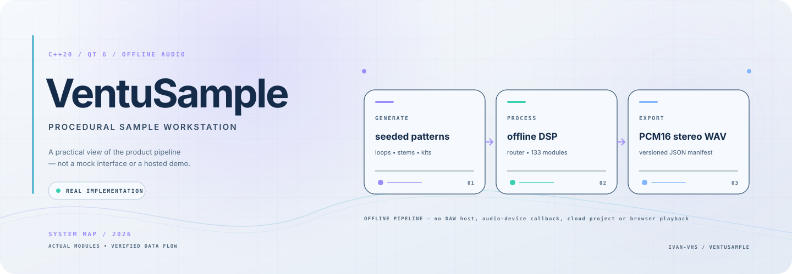

# VentuSample

VentuSample — нативна робоча станція на C++20 для процедурної генерації hip-hop семпл-паків і offline-обробки WAV, з опційним desktop-інтерфейсом Qt 6.

[English](README.md) · [Українська](README.uk.md) · [Русский](README.ru.md) · [简体中文](README.zh-CN.md)

<picture><source media="(prefers-color-scheme: dark)" srcset="assets/readme/dashboard.svg"></picture>

  

[Швидкий старт](#швидкий-старт) · [Знімки екрана](#знімки-екрана) · [Архітектура](#архітектура) · [План розвитку](#план-розвитку) · [Документація](docs/README.md)

> **Статус:** активна розробка. У репозиторії є ядро генерації C++20, допоміжна DSP-бібліотека C11, детерміновані тести та опційний desktop-застосунок Qt 6. CI збирає Linux core/Qt і Windows desktop.
>
> **Вимоги:** CMake 3.21+, компілятори C++20 і C11, Git. Для desktop UI потрібен Qt 6 Widgets; без Qt можна вимкнути desktop-ціль.

## Інтеграція з Reaper

VentuSample може використовувати версійований C17 ABI Reaper для детермінованих керувальних виразів і пошуку selfhood. Reaper не працює в real-time DSP: генерація, буфери, маршрутизація та offline-обробка залишаються в нативному C++20.

Докладніше: [інтеграція Reaper](docs/REAPER_RUNTIME_INTEGRATION.md).

## Швидкий старт

Linux із Qt 6:

~~~sh
sudo apt-get update
sudo apt-get install -y cmake ninja-build g++ qt6-base-dev
cmake -S . -B build -G Ninja -DCMAKE_BUILD_TYPE=Release -DVENTU_BUILD_DESKTOP=ON -DVENTU_BUILD_TESTS=ON
cmake --build build --parallel 2
ctest --test-dir build --output-on-failure
~~~

Переносне ядро без Qt:

~~~sh
cmake -S . -B build-core -DCMAKE_BUILD_TYPE=Release -DVENTU_BUILD_DESKTOP=OFF -DVENTU_BUILD_TESTS=ON
cmake --build build-core --parallel
ctest --test-dir build-core --output-on-failure
~~~

Windows із Visual Studio 2022 та налаштованим Qt 6:

~~~powershell
cmake -S . -B build -A x64 -DCMAKE_BUILD_TYPE=Release -DVENTU_BUILD_DESKTOP=ON -DVENTU_BUILD_TESTS=ON
cmake --build build --config Release --parallel 2
ctest --test-dir build -C Release --output-on-failure
~~~

## Можливості та межі

| Напрям | Реалізовано | Межа |
|---|---|---|
| Генератор | Full Loop, Melody, Drums, Bass, One-Shot Kit | Локальна генерація за параметрами та seed |
| Експорт | Stereo PCM16 WAV і версіонований JSON manifest | Локальні файли; наявні файли не перезаписуються |
| WAV input | PCM16 mono/stereo | Перевірка формату, frame count, частоти та розміру |
| Quantum Audio Engine | 133 типізовані ідентифікатори модулів і 21 повторно використовуване ядро | Offline DSP, не фізичні квантові обчислення |
| C11 DSP | Фільтри, компресор, сатурація, limiter, resampling і спектральні утиліти | Окрема bounded C11-бібліотека |
| Spectrum | FFT peak, spectral centroid, 85% rolloff | Лише наявні буфери; FFT 256–65 536 точок |
| MIDI | Читання Standard MIDI File format 0/1, нот, tempo і time signature | Read-only parser, без MIDI-пристроїв |
| Stochastic Router | Опційна seeded variation | Повторюваність за фіксованих параметрів і seed |
| Presets | Локальна schema v1 та A/B слоти | Шляхи локальних семплів не експортуються |
| Plugin tooling | 19 вбудованих інструментів і metadata-only discovery | Довільні DLL/SO не завантажуються |
| Reaper bridge | Опційний native C17 integer-expression ABI | Потрібен явний локальний checkout Reaper |

VentuSample — **не DAW, не real-time audio engine, не хост аудіопристроїв і не вебсервіс**. Генерація та DSP працюють із локальними буферами й файлами. Atomic-Quantum — класична симуляція, а не квантове обладнання.

## Чим відрізняється VentuSample

- Детермінована генерація семплів із локальними manifest-файлами, що зберігають параметри.
- Ядро C++20 та окрема тестована DSP-бібліотека C11.
- Offline-обробка не залежить від аудіопристроїв і real-time scheduler.
- Версіоновані presets підтримують A/B і не містять машинно-залежних шляхів.
- Опційні інтеграції ввімкнені явно; довільні native plugin binaries не завантажуються.

## Знімки екрана

<picture><source media="(prefers-color-scheme: dark)" srcset="assets/readme/workflow-dark.svg"></picture>

Знімок Windows 1920×1080 зі справжнього desktop CI workflow. Схема вище — векторна архітектурна ілюстрація.

## Архітектура

~~~mermaid
flowchart LR
 A[Параметри й seed] --> B[Генератор C++20]
 B --> C[Стерео float buffer]
 C --> D[Offline C11 DSP]
 D --> E[PCM16 WAV і JSON manifest]
 F[Опційний Qt 6 desktop] --> A
 G[Опційний Reaper C17 bridge] --> B
~~~

| Шлях | Призначення |
|---|---|
| src/ | Генератор C++20, DSP, presets та Qt desktop |
| src/compat/pytyliki-dsp/ | DSP-бібліотека C11 |
| tests/ | Тести генератора, DSP, presets і контрактів |
| schemas/ | Версіоновані JSON-схеми |
| docs/ | Audio, архітектура, UI, якість та інтеграції |
| assets/screenshots/ | Знімки Qt desktop |
| .github/workflows/ | Python contract checks, native tests і Qt builds |

## Presets та A/B

Presets використовують локальний версіонований JSON формат. Вони зберігають профіль звучання та параметри генерації/DSP; random seed не додається, якщо користувач явно не обирає його збереження. Два in-session A/B слоти перемикають параметри без запису файлів. Шляхи source samples не експортуються.

Схема: [Preset v1](schemas/ventusample.preset.v1.schema.json). Хмарної синхронізації немає; проєкт не заявляє права власності на імпортоване чи згенероване аудіо.

## Сумісність

| Ціль | Вимоги | CI / межі |
|---|---|---|
| Linux core і desktop | CMake 3.21+, C++20/C11 toolchain, Qt 6 Widgets для UI | Ubuntu 24.04, Qt 6 |
| Windows desktop | Visual Studio 2022, CMake 3.21+, Qt 6 Widgets | Windows Server 2022 runner, Qt 6.8.3 |
| Portable core | CMake 3.21+, компілятори C++20/C11 | VENTU_BUILD_DESKTOP=OFF |
| Python tooling | Python 3.10–3.12 | Лише інженерні перевірки |
| Reaper bridge | Опційне локальне дерево Reaper | REAPER_SOURCE_DIR задається явно |

Якщо Qt 6 Widgets недоступний, вимкніть desktop-ціль через VENTU_BUILD_DESKTOP=OFF і зберіть переносне ядро та тести.

## Оновлення README Revival

- На першому екрані є призначення, зрілість, toolchain і точні команди збірки/тестів.
- Реальний Windows-знімок відокремлено від архітектурної графіки.
- Світлі/темні SVG-активи локальні та однакового розміру.
- Offline-межі, Qt dependency, presets і plugin limits описані явно.

| Було | Стало |
|---|---|
| Огляд перед інструкціями збірки | Робочі build/test команди на початку |
| Графіка лише для однієї теми | Адаптивні локальні SVG |
| Опційні залежності описані пізно | Qt і Reaper bridge пояснені одразу |
| Опис безмежних можливостей | Таблиця реалізації та обмежень |

## План розвитку

- [x] Ядро генератора C++20 та DSP support library C11.
- [x] Offline WAV export, JSON manifest і validation source WAV.
- [x] Qt 6 desktop та детерміновані native tests.
- [x] Версіоновані локальні presets і A/B slots.
- [ ] Розширювати DSP із детермінованими fixtures і числовими regression tests.
- [ ] Додавати формати лише разом зі схемами, bounded parser і тестами сумісності.

## Екосистема

- [DuckOS](https://github.com/Ivan-VHS/DuckOS) — операційна система та робочий простір Mora.
- [Reaper](https://github.com/Ivan-VHS/Reaper) — системна мова й опційний native expression bridge.
- [Pytyliki](https://github.com/Ivan-VHS/Pytyliki) — процесорні дослідження та системні утиліти.
- [OPlague](https://github.com/Ivan-VHS/OPlague) — аналіз пристроїв і драйверів.

Дивіться [документацію](docs/README.md), [архітектуру](docs/ARCHITECTURE.md), [стандарт візуальних матеріалів](docs/README_VISUAL_STANDARD.md), [CONTRIBUTING](CONTRIBUTING.md) та [issues](https://github.com/Ivan-VHS/VentuSample/issues). Ліцензія: Apache-2.0.
