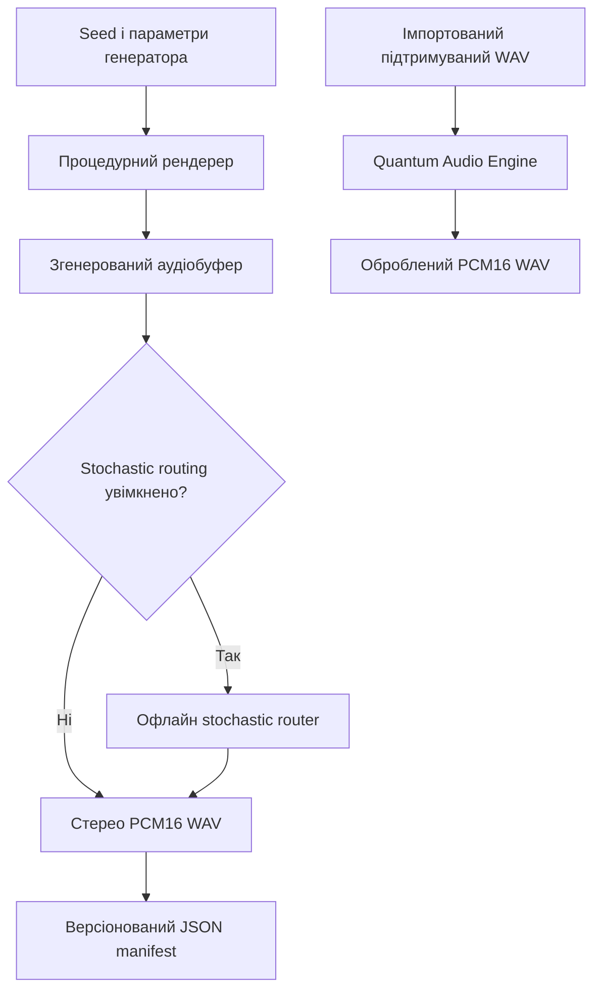
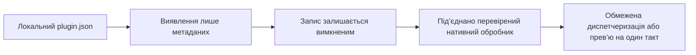

# VentuSample — процедурна робоча станція семплів

[CI](https://github.com/Ivan-VHS/VentuSample/actions/workflows/ci.yml) · C++20 · Qt 6 Widgets · Windows/Linux · офлайн · Apache-2.0

VentuSample — нативна робоча станція для детермінованої генерації хіп-хоп-семпл-паків. Скалярний рендерер експортує стерео PCM16 WAV і версійовані JSON-маніфести без DAW, аудіопристрою чи мережі.

[English](README.md) · [Русский](README.ru.md) · [Українська](README.uk.md) · [简体中文](README.zh-CN.md)

## Реальний знімок Windows
<p align="center"></p>
<sub>Фактичний знімок програми · вихідне зображення 1920×1080 · початкові пікселі збережено, штучне збільшення не застосовується.</sub>

## Потік генерації та обробки звуку

Перша схема показує поточний офлайн-шлях: генерацію із seed, необов’язкову стохастичну маршрутизацію та експорт WAV із manifest.



## Виявлення плагінів і межі виконання

Manifest плагінів перевіряються як метадані. Знайдений запис не виконується, доки до нього явно не під’єднано перевірений нативний обробник.



## Генератор
| Вихід | Вміст |
|---|---|
| Full Loop | ударні, мелодія, бас і необов’язкові вихідні chops |
| Melody | акорди та варіації нот із фіксованим seed |
| Drums | kick, snare, hats, percussion і rolls |
| Bass | басові патерни та необов’язковий glide |
| One-Shot Kit | 8 звуків; тональні мітки лише для звуків із висотою тону |

14 профілів: Boom Bap, Billionaire Golden Era, East Coast, Harlem Dip-Trap, G-Unit, Modern Trap, Atlanta Trap, UK Drill, UK Grime, Memphis, Jazz Rap, G-Funk, Boom Trap і Cripple Trill.

Діапазони: BPM 60–190; 1–16 тактів; 1–32 варіації; 6 сімейств гам; swing 50–68%; щільність/grit/сатурація/стерео 0–100%; high-pass 20–300 Гц; low-pass 2–20 кГц; зсув snare ±30 мс; bus compression 1:1–12:1; частота 22.05/44.1/48/96 кГц. Вихідний WAV: PCM16 mono/stereo, 8–192 кГц, ≤128 МіБ і ≤20 млн кадрів. Pitch chop ±12 півтонів, mix 0–100%.

## Внутрішня платформа плагінів
PluginManager містить 19 вбудованих інструментів. **Плагіни → Менеджер плагінів** підтримує перегляд, увімкнення/вимкнення та обмежений dispatch. Публічний SDK C++20 надає перевірювану реєстрацію обробників, відкладену ініціалізацію, callbacks завершення та діагностику. Рекурсивний пошук локальних `plugin.json` читає лише метадані; запис залишається вимкненим до явного підключення перевіреного нативного обробника. Автозавантаження DLL/SO, виконання коду з маніфесту, marketplace-інсталяція та заяви про sandbox не підтримуються. Контракт: [ivan-vhs.plugin.v1](schemas/ivan-vhs.plugin.v1.schema.json). Докладніше: [Plugin platform and SDK](docs/PLUGINS.md).

## Quantum Audio Engine — 133 DSP-модулі
**Плагіни → Quantum Audio Engine — 133 DSP** відкриває окрему офлайн-лабораторію: 133 стабільні ID у п’яти сімействах, обробка через 21 повторно використовуване перевірене DSP-ядро C++. Завантажте WAV, побудуйте ланцюг, налаштуйте Amount / Tone / Rate / Wet-Dry та експортуйте стерео PCM16 WAV. Це творча система обробки сигналу, а не фізичні квантові обчислення; вона не є real-time рушієм, DAW, VST/AU-хостом або завантажувачем довільних нативних бібліотек. Див. [Quantum Audio Engine](docs/QUANTUM_AUDIO_ENGINE.md).

## Atomic-Quantum 133
Окрема дослідницька бібліотека C++20 реєструє 133 атомарні/квантові ID та реалізує обмежену підмножину: перевірку стану, нормалізацію, Hadamard/phase/Pauli/CNOT/SWAP, Bell/GHZ, проєктивне вимірювання із seed, стохастичні траєкторії шуму та fidelity чистого стану. Це окрема система від аудіокаталогу; фізичні квантові обчислення не заявляються. Розширені функції залишаються в каталозі до незалежної реалізації й тестування числових моделей. Див. [Atomic-Quantum 133](docs/ATOMIC_QUANTUM_133.md).

## Стохастична маршрутизація
Необов’язковий **Stochastic Router** обробляє відрендерені буфери до експорту WAV. Зважений пул містить low-pass, high-pass, saturator, bitcrusher, delay, reverb, ring modulation і stereo width. Підтримуються топології hybrid/serial/parallel, тригери на файл/такт/подію, intensity 0–100%, wet ≤65%, feedback ≤72%, fades 5–20 мс, RMS compensation 0.5–2× і sample peak ≤−0.3 dBFS. Маршрут визначають seed, варіація, топологія, тригер і маска ефектів. Опцію вимкнено за замовчуванням; обробка виконується офлайн до PCM16-кодування, manifest v2 записує параметри маршруту. Це не real-time callback, hot-swap, VST/AU-хост чи завантажувач сторонніх плагінів.

## Збирання та тести
Потрібні CMake 3.21+, компілятор C++20 і Qt 6 Widgets для desktop-застосунку.
```sh
cmake -S . -B build -DCMAKE_BUILD_TYPE=Release -DVENTU_BUILD_DESKTOP=ON -DVENTU_BUILD_TESTS=ON
cmake --build build --parallel
ctest --test-dir build --output-on-failure
```
Без Qt переносиме DSP-ядро й тести можуть збиратися окремо. CI перевіряє контракти Python, нативний C++20 і Qt-збирання на Linux та Windows.

## Експорт та обмеження
- Фіксовані seed і налаштування дають повторюваний рендер; обробка працює в робочому потоці.
- Manifest v2 записує налаштування, `musical_key`, `mode_family`, `scale` і peak/RMS/crest; manifest v1 залишається читабельним.
- Full Loop, Melody і Bass можуть мати мітки тональності/ладу; ударні без висоти тону — ні. Імпортовані WAV автоматично не аналізуються на тональність.
- Master ceiling близько −0.3 dBFS sample peak; це не oversampled true-peak limiter.
- Ресемплінг у півтонах змінює висоту й швидкість одночасно; це не time-stretching.
- Немає мережевої телеметрії, фонового захоплення аудіо, real-time callback або неявного завантаження нативних бібліотек.
- Для імпорту/експорту потрібні права на вихідний матеріал. Хеш підтверджує ідентичність байтів, але не право власності.

[Apache-2.0](LICENSE)


## Довідник розподілу бюджету
Приклад моделі бюджету 500 грн із JSON-контрактом та автономним симулятором. Це документаційний приклад, а не функція runtime самого застосунку.

[Багатомовний довідник](docs/RESOURCE_ALLOCATION_500_UAH.md) · [Інтерактивний симулятор](docs/resource-allocation-500-uah.html) · [Приклад JSON](examples/resource-allocation-500-uah.json) · [JSON Schema](schemas/resource-allocation.v1.schema.json)

## Підтримка Elbrus E2K

Нативне ядро C++20, обмеження підтримки стандарту LCC, необов'язковий Qt Desktop і перевірки платформи описані в [посібнику з Elbrus E2K](docs/ELBRUS_E2K.md).
