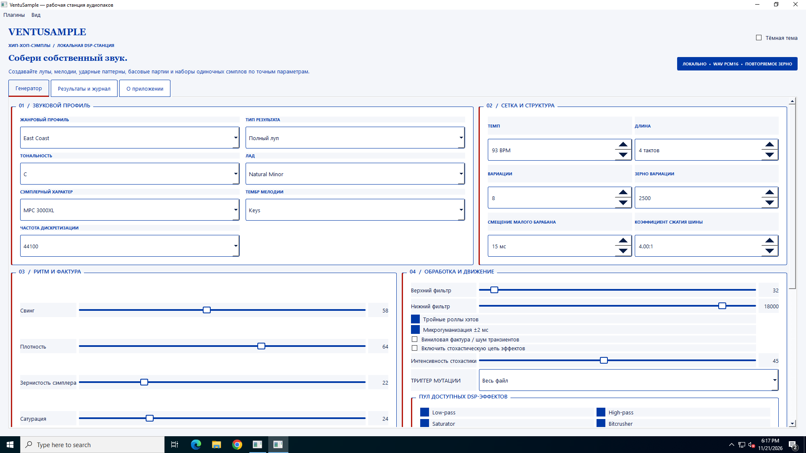

# VentuSample — офлайн робоча станція процедурного аудіо

[English](README.md) · [Українська](README.uk.md) · [Русский](README.ru.md) · [简体中文](README.zh-CN.md)

  

> Детермінована генерація семплів на C++20 та offline DSP з обмеженим WAV I/O, відтворюваною маршрутизацією й версіонованими manifest наборів.

**Відомості про проєкт:** розробка · версія 0.2.0 · ядро C++20 та DSP compatibility layer на C11 · необов’язковий desktop Qt 6 Widgets · offline-рендеринг · Apache-2.0 · **Документацію перевірено:** 2026-11-27 UTC

## Призначення та архітектура

VentuSample створює відтворювані набори семплів і локально обробляє аудіофайли. Ядро C++20 відповідає за перевірку параметрів, генерацію патернів із seed, стереообробку, offline DSP-маршрутизацію, імпорт/експорт WAV і формування manifest. Сумісний шар C11 надає низькорівневі DSP- та MIDI/file-примітиви. Необов’язковий застосунок Qt 6 Widgets забезпечує desktop-інтерфейс, але не є real-time аудіохостом.

~~~mermaid
flowchart TB
  U["Профіль / seed / параметри"] --> V["Перевірка й ресурсні межі"]
  V --> G["Планувальник патернів і renderer"]
  G --> F["Стерео float processing"]
  F --> D["Offline DSP і stochastic routing"]
  D --> M["Master / RMS і peak guard"]
  M --> W["Обмежені PCM16 WAV assets"]
  V --> J["Версіонований pack manifest v1/v2"]
  W --> P["Локальний sample pack"]
  J --> P
  Q["Необов’язковий Qt 6 desktop"] --> U
~~~

## Можливості

- **Процедурна генерація:** детерміновані стереопатерни із seed за 14 документованими hip-hop і суміжними профілями, включно з редагованим профілем Billionaire Golden Era.
- **Golden-era crate workflow:** детерміноване компонування чотирьох зрізів у порядку 0–2–1–3, зважений добір kick/snare, стримані hats, спільний swing і відтворювані переходи.
- **Імпорт і нарізка WAV:** обмежений PCM16 mono/stereo input (8–192 kHz, до 128 MiB і 20 млн кадрів), розміщення чотирьох зрізів і ресемплінг на ±12 півтонів. Зміна висоти тону також змінює швидкість; time-stretch зі збереженням темпу не реалізовано.
- **Offline DSP:** фільтри, saturation, обробка зв’язаної стереошини, RMS matching, захист sample peak та обмежена маршрутизація ефектів.
- **Stochastic router:** вісім зважених ефектів у serial, parallel і hybrid-графах; тригери file/bar/generator-onset; детермінована маршрутизація за seed/variation; wet ≤65%, feedback ≤72%, fades 5–20 ms, обмежена RMS-компенсація та sample-peak-захист −0,3 dBFS. Інтегрований в offline WAV export і представлений як 19-й вбудований плагін.
- **Аналіз:** peak, RMS і crest factor для файлів; offline FFT peak, centroid і rolloff на 85%. Доступ до аудіопристроїв не потрібен.
- **QMR-20:** 20 параметрів якості, cohesion і ритміки з regression gates; це детерміновані інженерні перевірки, а не універсальна чи суб’єктивна оцінка звучання.
- **Тональні метадані:** key/mode додаються лише до тонального матеріалу; ударним без визначеної висоти не призначається вигадана тональність.
- **Обмін наборами:** manifest `ventusample.pack.v1` і `ventusample.pack.v2` з WAV assets. Поточний Reaper consumer перевіряє й порівнює метадані manifest v1, не аналізуючи та не змінюючи waveform.

Профілі — оригінальні процедурні патерни, а не записи й не заява про відтворення конкретного артиста. За імпортоване аудіо відповідає користувач; програма не встановлює авторських прав чи ліцензійної чистоти матеріалу.

## Збирання та перевірка

Потрібні CMake 3.21+, компілятор C++20 і компілятор C для DSP-шару C11. Qt 6 Widgets необов’язковий. Переносне ядро й тести можна збирати без Qt.

~~~sh
cmake -S . -B build -DCMAKE_BUILD_TYPE=Release -DVENTU_BUILD_DESKTOP=ON -DVENTU_BUILD_TESTS=ON
cmake --build build --parallel 2
ctest --test-dir build --output-on-failure
~~~

Переносне ядро без Qt:

~~~sh
cmake -S . -B build-core -DCMAKE_BUILD_TYPE=Release -DVENTU_BUILD_DESKTOP=OFF -DVENTU_BUILD_TESTS=ON
cmake --build build-core --parallel
ctest --test-dir build-core --output-on-failure
~~~

Desktop-ціль створюється лише за наявності Qt 6 Widgets. Без SDK переносне ядро й доступні тести все одно можна зібрати.

## Межі аудіо та файлів

| Поверхня | Контракт | Межа |
|---|---|---|
| Presets | `ventusample.preset.v1` | Перевірені локальні налаштування |
| Pack exchange | `ventusample.pack.v1 / v2` | JSON manifest і WAV assets |
| Audio output | RIFF PCM16 stereo WAV | Обмежений локальний render з peak/RMS metadata |
| DSP graph | Native offline DSP | Без real-time VST/AU hosting |
| Analysis | Offline FFT і метрики файлів | Локальні дані; без захоплення з аудіопристрою |

Рендеринг виконується offline. Наразі проєкт не надає real-time playback, аудіорушія з доступом до пристроїв, VST/AU-хоста, time-stretch зі збереженням темпу або GPU dispatch. Не заявляються фіксована real-time затримка, обсяг RAM або універсальна продуктивність для всіх sample rate.

## Тести та докази продуктивності

CTest перевіряє детерміновану генерацію, WAV boundaries, ресемплінг, MIDI-файли, offline spectrum analysis, маршрутизацію плагінів і runtime-транзакції. UI-тести Qt реєструються лише за наявності Qt 6 Widgets. Відсотки coverage або fuzzing не заявляються без опублікованих звітів.

Тести підтверджують детерміновану й обмежену поведінку, а не затримку real-time playback чи універсальний рейтинг обладнання.

## Інтеграції та документація

Обмін із Reaper використовує файли й версіоновані формати. Поточний Reaper consumer читає метадані manifest v1 і не змінює WAV assets. Необов’язкова інтеграція нативних виразів Reaper вмикається лише за явного передавання локального дерева вихідного коду Reaper до CMake. Прямий адаптер нативних метрик/DSP Pytyliki поки запланований.

- [Матриця функцій](docs/FEATURES.md) · [Архітектура](docs/ARCHITECTURE.md)
- [CRATE feature details](docs/FEATURES.md) · [Hip-hop preset examples](examples/compare_packs.py)
- [Quality Monolith Rhythm](docs/QUALITY_MONOLITH_RHYTHM.md) · [Quantum Audio Engine](docs/QUANTUM_AUDIO_ENGINE.md)
- [Плагіни та lifecycle](docs/PLUGINS.md) · [MIDI та ресемплінг](docs/MIDI_AND_RESAMPLING.md)
- [Інтеграція вихідного коду та ліцензії](docs/SOURCE_INTEGRATION.md) · [Індекс документації](docs/README.md)
- [Контроль документації](docs/DOCUMENTATION_CONTROL.md)

## Безпека, внесок і ліцензія

Вважайте імпортовані WAV і preset packs недовіреними даними. Перед обробкою перевіряйте розмір файлу, RIFF chunks, кількість кадрів і заявлені формати. Зовнішні native-бібліотеки не завантажуються неявно. Керування драйверами, прошивкою та системним аудіо не виконується.

Перед зміною DSP-поведінки, форматів файлів або plugin-контрактів прочитайте [CONTRIBUTING.md](CONTRIBUTING.md). Ліцензія проєкту — [Apache-2.0](LICENSE); зберігайте повідомлення сторонніх компонентів.
