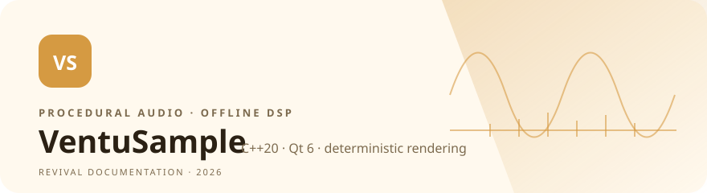
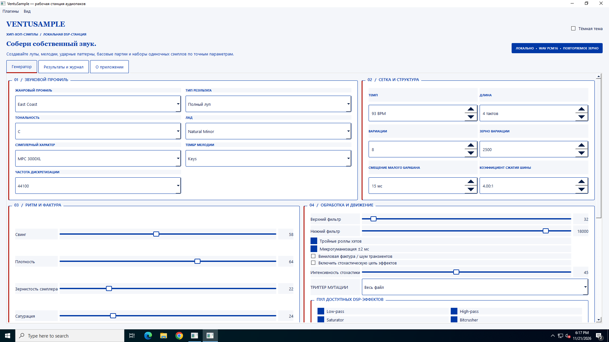
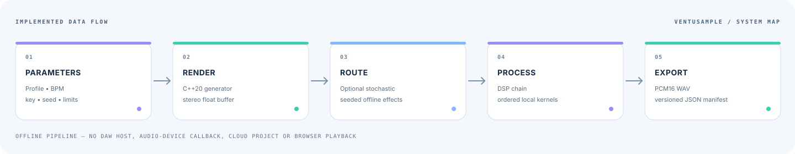

<picture><source media="(prefers-color-scheme: dark)" srcset="assets/readme/hero-banner-dark.svg"><source media="(prefers-color-scheme: light)" srcset="assets/readme/hero-banner-light.svg"></picture>

<h1 align="center">VentuSample — 程序化采样工作站</h1>

<strong>离线 C++20 工作站，用于确定性采样生成、经过验证的 WAV 导入、创意 DSP 处理和 PCM16 导出。</strong>

 

[快速开始](#快速开始) · [Revival 更新](#文档-revival-更新) · [视觉概览](#视觉概览) · [架构](#架构) · [文档索引](docs/README.md)

> **产品边界：**VentuSample 离线生成和处理音频。它不是实时音频引擎、DAW、VST/AU host 或云服务。可选 Qt 6 桌面外壳与可移植 DSP/core 构建分离。发现 plugin manifest 并不意味着加载代码。

## 快速开始

**环境要求：**CMake 3.21+、C++20 编译器（GCC、Clang 或 MSVC）和 Git。桌面应用需要 Qt 6 Widgets；核心可在没有 Qt 时构建。Ninja 可选。

Linux 桌面构建（CI 使用 Ubuntu 24.04 软件包）：

~~~sh
sudo apt-get update
sudo apt-get install -y cmake ninja-build g++ qt6-base-dev
git clone https://github.com/Ivan-VHS/VentuSample.git
cd VentuSample
cmake -S . -B build -G Ninja -DCMAKE_BUILD_TYPE=Release -DVENTU_BUILD_DESKTOP=ON -DVENTU_BUILD_TESTS=ON
cmake --build build --parallel 2
ctest --test-dir build --output-on-failure
./build/VentuSample
~~~

不使用 Qt 构建可移植核心：

~~~sh
cmake -S . -B build-core -DCMAKE_BUILD_TYPE=Release -DVENTU_BUILD_DESKTOP=OFF -DVENTU_BUILD_TESTS=ON
cmake --build build-core --parallel
ctest --test-dir build-core --output-on-failure
~~~

Windows 使用 MSVC 和 Qt 6：

~~~sh
cmake -S . -B build -A x64 -DCMAKE_BUILD_TYPE=Release -DVENTU_BUILD_DESKTOP=ON -DVENTU_BUILD_TESTS=ON
cmake --build build --config Release --parallel 2
ctest --test-dir build -C Release --output-on-failure
~~~

## 文档 Revival 更新

| 之前 | Revival 文档 |
|---|---|
| 单一静态 Hero | 浅色/深色主题配对 SVG，并提供可访问回退 |
| 生成器、DSP 和桌面 UI 混合描述 | 明确离线渲染流程和产品边界 |
| 截屏与流程图未明确区分 | 真实 Studio 截屏与单独标注的数据流程图 |
| 构建方式隐藏在长说明中 | 分别说明 Linux 桌面、Windows 桌面和无 Qt 核心构建 |
| 功能状态分散在详细页面 | 摘要链接到 DSP、插件与架构契约 |

这是文档更新，**不代表软件版本升级或新 Release**。渲染行为与成熟度以代码、测试、manifest 和 schema 为准。

## 已实现范围

| 领域 | 当前行为 | 边界 |
|---|---|---|
| 程序化生成器 | Loop、Melody、Drums、Bass、One-Shot Kit；14 种 profile | 固定 seed 和设置时可复现 |
| 音频 I/O | PCM16 WAV 导入/导出和版本化 JSON manifest | 经过验证的本地文件，无云同步 |
| 离线 DSP | 滤波、饱和、立体声联动压缩、限制器和测量 | 离线缓冲区，无音频设备回调 |
| Quantum Audio Engine | 类型化模块目录与可复用处理 kernel | 创意 DSP 分类，不是物理量子计算 |
| Stochastic Router | 可选 seeded 内置处理器路由 | 离线处理，默认关闭 |
| Plugin Manager | 内置工具和经过审查的 C++ handler API | 元数据发现不会加载任意 DLL/SO |
| MIDI / 分析 | 有界 MIDI 检查和离线 FFT 测量 | 无 MIDI 设备或播放路径 |
| Reaper bridge | 可选 C17 整数表达式 ABI | 显式本地源码路径，不属于 DSP 引擎 |

## 视觉概览

<table><tr><td width="50%">
<strong>真实桌面截屏</strong> — 正在运行的应用程序，并非模型图。
</td><td width="50%">
<strong>架构示意图</strong> — 音频数据流程，并非 UI 截图。
</td></tr></table>

## 架构

~~~mermaid
flowchart LR
  A[参数 + seed] --> B[C++20 generator]
  B --> C[Stereo float buffer]
  C --> D[可选离线 DSP / routing]
  D --> E[PCM16 WAV]
  D --> F[版本化 JSON manifest]
  G[Qt 6 desktop shell] --> A
  H[已验证 WAV 输入] --> D
  I[Native tests] --> B
~~~

## 配置与信任

项目不需要根目录 .env、账户、API Token 或网络连接。实际 CMake 选项：

| 选项 | 默认值 | 用途 |
|---|---:|---|
| VENTU_BUILD_DESKTOP | ON | Qt 6 Widgets 可用时构建桌面目标 |
| VENTU_BUILD_TESTS | ON | 构建原生测试 |
| VENTU_ENABLE_SANITIZERS | OFF | 在受支持 GCC/Clang 中启用 ASan/UBSan |
| REAPER_SOURCE_DIR | 空 | 可选表达式 bridge 的显式本地 Reaper checkout |

插件 manifest 仅作为元数据发现。只有附加经过审查的原生 C++ handler 后插件才会启用；不会加载任意 entrypoint 或 DLL/SO。

## 仓库结构

| 路径 | 职责 |
|---|---|
| src/ | C++20 生成器、渲染器、DSP kernel、插件管理器、Qt UI 和可选 bridge |
| src/compat/pytyliki-dsp/ | 迁移的 C11 缓冲区处理库 |
| integrations/cockos-reaper/ | 可选 REAPER Lua helper actions |
| tests/ | 原生 DSP、生成器、manifest、UI 和回归测试 |
| schemas/ | 版本化 preset、plugin 和 report 契约 |
| docs/ | 音频流程、插件、预设、架构和 UI 契约 |
| assets/readme/ | 主题适配 Hero 和流程示意图 |
| assets/screenshots/ | 桌面 UI 实际截屏 |
| .github/workflows/ | Native CI 和项目质量检查 |

## 验证与当前状态

~~~sh
cmake --build build --config Release --parallel
ctest --test-dir build -C Release --output-on-failure
git diff --check
~~~

参见 [架构](docs/ARCHITECTURE.md)、[功能矩阵](docs/FEATURES.md)、[Plugin Manager](docs/PLUGINS.md)、[MIDI 与重采样](docs/MIDI_AND_RESAMPLING.md) 和 [Quantum Audio Engine](docs/QUANTUM_AUDIO_ENGINE.md)。CI 截图属于 workflow artifact；测试通过不代表已部署 Web 服务或发布 Windows 安装包。

## 参与开发

请阅读 [CONTRIBUTING.md](CONTRIBUTING.md)、[README Visual Standard](docs/README_VISUAL_STANDARD.md) 和 [SECURITY.md](SECURITY.md)。DSP、文件限制、manifest 或 plugin lifecycle 的修改需要针对性的原生测试。

## 许可证

[Apache-2.0](LICENSE)。
