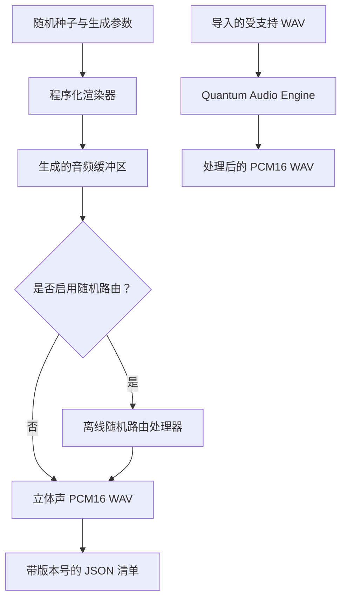

# VentuSample — 程序化采样工作站

[CI](https://github.com/Ivan-VHS/VentuSample/actions/workflows/ci.yml) · C++20 · Qt 6 Widgets · Windows/Linux · 离线 · Apache-2.0

VentuSample 是一款用于确定性生成嘻哈采样包的原生工作站。标量渲染器可导出 PCM16 立体声 WAV 和带版本号的 JSON 清单，无需 DAW、音频设备或网络连接。

[English](README.md) · [Русский](README.ru.md) · [Українська](README.uk.md) · [简体中文](README.zh-CN.md)

## Windows 实际运行截图
<p align="center"></p>
<sub>应用实际截屏 · 原始图像为 1920×1080 · 保留原始像素，不进行人为放大。</sub>

## 音频生成与处理流程

第一张图展示当前离线路径：从带种子的生成开始，经可选随机路由，最终输出 WAV 和清单。



## 插件发现与执行边界

插件 manifest 仅作为元数据读取。发现条目必须显式关联经过审查的原生处理器后才可执行。


## 生成器
| 输出 | 内容 |
|---|---|
| Full Loop | 鼓组、旋律、低音和可选源素材切片 |
| Melody | 和弦与带固定 seed 的音符变化 |
| Drums | kick、snare、hats、percussion 和 rolls |
| Bass | 生成的低音模式和可选 glide |
| One-Shot Kit | 8 个采样；仅为有音高的声音标注音名 |

包含 14 种配置：Boom Bap、Billionaire Golden Era、East Coast、Harlem Dip-Trap、G-Unit、Modern Trap、Atlanta Trap、UK Drill、UK Grime、Memphis、Jazz Rap、G-Funk、Boom Trap 和 Cripple Trill。主要范围：BPM 60–190；1–16 小节；1–32 种变化；6 个音阶系列；Swing 50–68%；密度/grit/饱和度/立体声 0–100%；high-pass 20–300 Hz；low-pass 2–20 kHz；snare 偏移 ±30 ms；总线压缩 1:1–12:1；采样率 22.05/44.1/48/96 kHz。源 WAV 为 PCM16 mono/stereo、8–192 kHz、≤128 MiB、≤2000 万帧。Chop 音高 ±12 半音，混合 0–100%。

## 内置插件平台
原生 PluginManager 包含 19 个内置工具。**Плагины → Менеджер плагинов** 支持检查、启用/禁用和有界 dispatch。公开 C++20 SDK 提供经过审核的处理器注册、延迟初始化、关闭回调和诊断接口。本地 `plugin.json` 清单可递归发现，但只读取元数据；条目在明确附加经过审核的原生处理器前保持禁用。不支持自动加载 DLL/SO、按清单执行代码、marketplace 安装或声称提供 sandbox。清单契约：[ivan-vhs.plugin.v1](schemas/ivan-vhs.plugin.v1.schema.json)。详见[插件平台与 SDK](docs/PLUGINS.md)。

## Quantum Audio Engine — 133 个 DSP 模块
**Плагины → Quantum Audio Engine — 133 DSP** 打开独立离线实验室：五个系列共 133 个稳定 ID，通过 21 个可复用且经过测试的 C++ DSP 内核处理信号。载入 WAV、组装处理链、调整 Amount / Tone / Rate / Wet-Dry 并导出立体声 PCM16 WAV。它是创意信号处理系统，不是物理量子计算，也不是实时音频引擎、DAW、VST/AU 主机或任意原生库加载器。详见 [Quantum Audio Engine](docs/QUANTUM_AUDIO_ENGINE.md)。

## Atomic-Quantum 133
独立的 C++20 研究库注册 133 个原子/量子操作 ID，并实现有界子集：状态验证、归一化、Hadamard/phase/Pauli/CNOT/SWAP 门、Bell/GHZ 制备、带 seed 的投影测量、随机噪声轨迹和纯态保真度。它与音频目录相互独立，并非物理量子计算。高级功能在数值模型经过独立实现和测试前仅保留在目录中。详见 [Atomic-Quantum 133](docs/ATOMIC_QUANTUM_133.md)。

## 随机路由
可选的 **Stochastic Router** 在 WAV 导出前处理已渲染音频缓冲区。加权池包含 low-pass、high-pass、saturator、bitcrusher、delay、reverb、ring modulation 和 stereo width。支持 hybrid/serial/parallel 拓扑、按文件/小节/事件触发、intensity 0–100%、wet ≤65%、feedback ≤72%、淡入淡出 5–20 ms、RMS compensation 0.5–2× 和 sample peak ≤−0.3 dBFS。路由由 seed、变化项、拓扑、触发方式和效果掩码决定。此选项默认关闭；处理在 PCM16 编码前离线执行，manifest v2 记录路由参数。它不是实时回调、播放热切换系统、VST/AU 主机或第三方插件加载器。

## 构建与测试
要求 CMake 3.21+、C++20 编译器；桌面应用还需要 Qt 6 Widgets。
```sh
cmake -S . -B build -DCMAKE_BUILD_TYPE=Release -DVENTU_BUILD_DESKTOP=ON -DVENTU_BUILD_TESTS=ON
cmake --build build --parallel
ctest --test-dir build --output-on-failure
```
没有 Qt 时，仍可构建可移植 DSP 核心和测试；CI 会检查 Python 契约、原生 C++20 代码，并在 Linux 和 Windows 上构建 Qt 桌面应用。

## 导出与限制
- 固定 seed 和设置会产生可重复渲染；处理在工作线程中执行。
- Manifest v2 记录设置、`musical_key`、`mode_family`、`scale` 和 peak/RMS/crest；manifest v1 仍可读取。
- Full Loop、Melody 和 Bass 可附带调性/调式标签；无音高鼓组不会添加标签。不会自动检测导入 WAV 的调性。
- Master ceiling 约为 −0.3 dBFS sample peak；它不是过采样 true-peak limiter。
- 半音重采样会同时改变音高和播放速度；它不是 time-stretching。
- 没有网络遥测、后台音频捕获、实时回调或隐式原生库加载。
- 导入和导出必须拥有源素材使用权。哈希只能证明字节一致，不能证明所有权。

[Apache-2.0](LICENSE)


## 预算分配参考
这是一个 500 UAH 预算模型示例，包含 JSON 契约和离线模拟器。它属于文档示例，并非宿主应用运行时功能。

[多语言指南](docs/RESOURCE_ALLOCATION_500_UAH.md) · [交互式模拟器](docs/resource-allocation-500-uah.html) · [JSON 示例](examples/resource-allocation-500-uah.json) · [JSON Schema](schemas/resource-allocation.v1.schema.json)

## 安全文档

[信任边界与安全操作](docs/SECURITY_AND_TRUST_BOUNDARIES.md) · [Beelzebul AppGuard 666 目录](docs/BEELZEBUL_APPGUARD_666.md) · [完整文档索引](docs/README.md)
