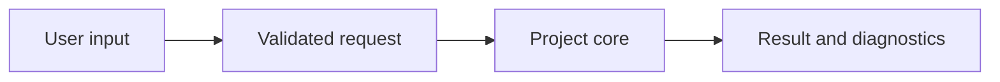

# README & Visual Documentation Standard v2026.11

This is the shared publishing contract for this repository's README family, documentation index, technical Markdown, diagrams, screenshots and visual assets. Source code, tests, schemas, release artifacts and project-specific UI contracts remain authoritative for product behavior.

## 1. Publishing principles

1. **Truth before promotion.** Describe only behavior that exists and can be demonstrated. Distinguish `Implemented`, `Partial`, `Reference`, `Planned` and `Catalogued`; a registry count is not a completion count.
2. **One canonical explanation.** Keep detailed contracts in `docs/`; let the root README summarize and link to them. Avoid competing copies of the same specification.
3. **Fast orientation.** Readers should quickly understand the product, platform, maturity, safety boundary and first run.
4. **Native rendering first.** Prefer GitHub-flavoured Markdown and repository-relative assets. Add generators or client-side components only when they solve a documented need.
5. **Accessible by default.** Images need useful alt text, diagrams need a text explanation, and contrast, keyboard focus and reduced-motion behavior must remain understandable.
6. **Project-specific accuracy.** Shared visual rules do not imply that every project ships the same feature, theme, animation or control.

## 2. README information architecture

Keep root `README.md` as the canonical English entry point. Keep `README.ru.md`, `README.uk.md` and `README.zh-CN.md` aligned with it.

Recommended order (omit inapplicable sections):

1. Project name and one-sentence value statement.
2. Build / CI / release / license / platform metadata; badges only when their targets are real and maintained.
3. A current application screenshot or clear product preview.
4. Product purpose and a compact capability/status matrix.
5. Quick start: prerequisites, build, run and test commands checked against the repository.
6. Key workflows, examples or a small architecture diagram.
7. Explicit limitations, safety boundaries, data handling and compatibility notes.
8. Links to focused technical documents and the documentation index.
9. Language switcher, license and contribution/support links where applicable.

Use the root README for orientation, not as a dumping ground for every registry, API catalogue or historical proposal. Long contracts belong in focused documents reachable from `docs/README.md`.

## 3. Markdown, MDX and document structure

- Use `.md` by default. GitHub renders repository Markdown directly and supports relative links and image paths.
- Use `.mdx` only when an actual MDX documentation site needs executable components. A `README.mdx` file is not a substitute for a GitHub-friendly `README.md`.
- Do not introduce Docusaurus, VitePress, Astro Starlight, MkDocs or Material for MkDocs merely to decorate a repository. Choose one documentation site only when versioned navigation, search, multilingual routing or a hosted manual is genuinely needed.
- Framework fit is deliberate: Docusaurus is React/MDX-oriented; VitePress is Vue/Vite-oriented; Starlight is Astro's documentation theme; MkDocs is a Python documentation generator with theme/plugin choices. Do not combine multiple generators for the same content.
- Use one H1 per document, headings in logical order, descriptive link labels, language-tagged code fences and compact tables. Add a table of contents only when it improves navigation.
- Prefer relative links for repository files. Check path casing and targets; GitHub paths are case-sensitive. Avoid local-machine paths and temporary CI artifact links.
- Keep examples executable or label them illustrative. Never include secrets, tokens, personal data or unsafe copy-paste commands.

## 4. Screenshots and visual assets

### Screenshots

- Use real application captures from a repeatable desktop-build or screenshot workflow. Never present a mockup, generated illustration or concept render as a live application capture.
- Store captures under the existing screenshot directory (normally `assets/screenshots/`). Use stable, descriptive filenames and refresh them after material UI changes.
- Prefer a readable 16:9 desktop capture (for example, 1920×1080) with the relevant workflow visible. Crop unrelated desktop clutter without removing important controls or context.
- Include useful alt text and a short caption stating what is shown and, where useful, the platform or capture workflow.
- Keep a full-resolution source when publishing a smaller preview; avoid duplicate captures that differ only by filename.

### Format selection

| Format | Preferred use | Rule |
|---|---|---|
| SVG | diagrams, icons and scalable interface illustrations | Keep source editable; avoid scripts, remote dependencies and embedded secrets. |
| PNG | application screenshots, UI captures and lossless diagrams | Preferred screenshot source/master. |
| WebP | optimized raster previews | Use after verifying the target renderer; retain the source asset. |
| AVIF | high-compression web previews | Optional; verify GitHub and site rendering and provide a safe fallback. |
| JPEG | photographs where lossy compression is acceptable | Avoid for text-heavy UI captures and diagrams. |

Use repository-relative paths. Compress large raster assets without making UI details unreadable. Do not rely on an experimental format for the only copy of an important screenshot.

### Alt text and captions

Alt text must communicate purpose, not repeat the filename. Aim for 40–150 characters where practical. Identify the visual type (“Screenshot of…” / “Diagram showing…”), describe the important state or relationship, and end naturally. Put version, OS, workflow and other volatile metadata in the caption instead of overloading alt text.

## 5. Diagrams and technical visualization

- **Mermaid** is the default for small flowcharts, sequence diagrams, state diagrams and dependency views. GitHub renders Mermaid blocks in Markdown.
- **PlantUML** and **D2** are appropriate when their notation or existing toolchain is justified. Keep editable source beside the document and publish a checked SVG/PNG export for renderers that cannot process it.
- Never make a critical explanation depend solely on a remote rendering service.
- Keep each diagram focused: one question per diagram, readable labels, clear direction, named boundaries and a short text explanation.
- Do not use color as the only way to distinguish states. Add labels, shapes or line styles.
- Never invent architecture: verify nodes and edges against code, tests or an authoritative contract.

Example (replace nodes with verified project components before publishing):



## 6. Visual language, motion and accessibility

- Use semantic tokens for canvas, surfaces, borders, text, accents, status and focus instead of unrelated hard-coded colors.
- Preserve contrast in light and dark themes. Communicate status with text or symbols as well as color.
- Provide visible keyboard focus, logical reading order, clear labels, predictable disabled/loading/error/success states and controls sized for their input method.
- Respect operating-system and application reduced-motion preferences. Parallax, looping motion, particles and decorative transitions must not carry required information or block input.
- Keep motion away from latency-sensitive work: rendering, audio/DSP callbacks, worker control paths and device operations must not depend on decorative UI animation.
- Make layouts readable on narrow screens and at increased text scale. Screenshots supplement, not replace, written instructions.

## 7. Navigation, localization and discoverability

- Keep `docs/README.md` as the curated documentation index. Group documents by user task or system area as the index grows.
- Maintain a single language switcher pointing to real files. Keep core facts, feature maturity, commands, screenshots and safety limitations aligned across all four README languages.
- Translate explanatory prose; preserve API names, commands, paths, identifiers and established product terminology.
- Keep badges, Shields.io links and GitHub Actions status indicators only when the workflow or endpoint exists. A badge is status metadata, not proof that every release is healthy.
- Add Open Graph / social-preview artwork only when it improves discovery; keep it aligned with the real product identity and readable at small sizes.

## 8. Documentation quality gates

Before merging documentation changes, check:

- [ ] Root README and all language variants tell the same current story.
- [ ] Every internal link, image path, badge and workflow URL resolves.
- [ ] Screenshots are real, current, readable and described with useful alt text.
- [ ] Commands, supported platforms, versions, counts and capability labels match code, tests and CI.
- [ ] Diagrams match verified architecture and include a text explanation.
- [ ] No unsupported performance, security, compatibility or certification claims were added.
- [ ] Markdown has no broken tables, malformed fences, duplicate H1s or trailing whitespace.
- [ ] The documentation index links to new or changed technical contracts.

Recommended local check:

```sh
git diff --check
```

Run existing CI and configured documentation/link checks. Do not add a dependency solely to satisfy this checklist; prefer a small, maintained check integrated with the current toolchain.

## 9. Reference documentation

- [GitHub: writing and formatting](https://docs.github.com/en/get-started/writing-on-github/getting-started-with-writing-and-formatting-on-github/basic-writing-and-formatting-syntax)
- [GitHub: diagrams with Mermaid](https://docs.github.com/en/get-started/writing-on-github/working-with-advanced-formatting/creating-diagrams)
- [Docusaurus](https://docusaurus.io/docs)
- [VitePress](https://vitepress.dev/)
- [Astro Starlight](https://starlight.astro.build/)
- [MkDocs](https://www.mkdocs.org/)

---

**Repository rule:** this standard defines how information is published. The project's code, tests, schemas, release artifacts and project-specific UI contracts define what is actually implemented.
